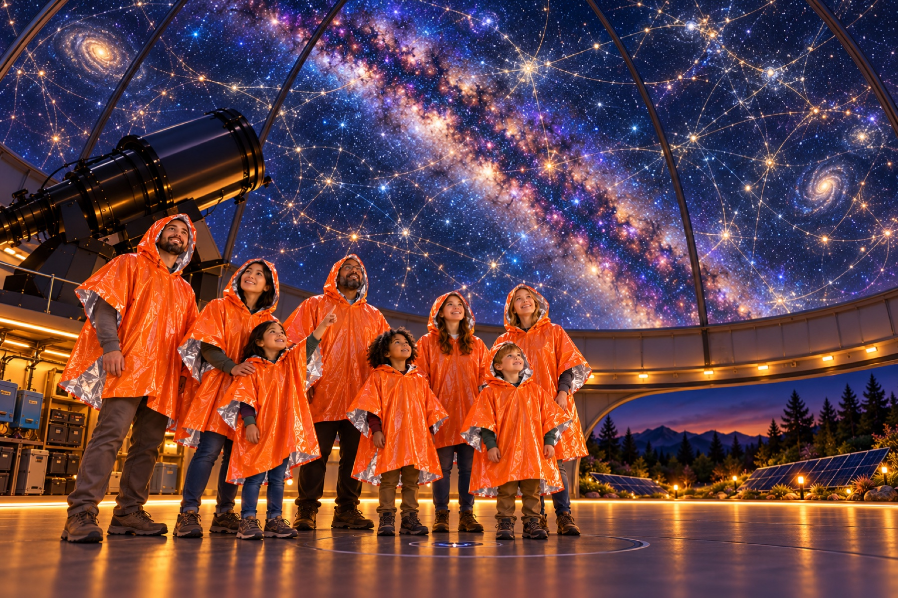

# Travelling Through Space In Time

> “You're traveling through another dimension, a dimension not only of sight and sound but of mind; a journey into a wondrous land whose boundaries are that of imagination.”
>
> — Rod Serling, opening narration for *The Twilight Zone*

**A.R.G.O. — Astrarium Research & Galactic Observatory**

*The crew stays with the observatory. The far-reaching lines are a picture of the mind-journey we want to explore; Astrarium has not calculated a physical path that carries information to the ancient sky.*

## Start here: what are we trying to do?

Imagine a crew staying aboard A.R.G.O. while their minds take an excursion through a stream of distant events. The crew's bodies remain in the cabin and their clock advances by minutes; what they see and know is connected to remote places and times by a continuous information path. Earth and the other planets keep moving, so we need their positions to understand the view and what that path passes near.

Here, “dimension of mind” names the crew's layer of experience. It does not by itself mean an extra spatial dimension in the equations.

In this book's mission, A.R.G.O. remains at its home location while the crew experiences a mind-journey linked to an appearance associated with the Star of Bethlehem. We also ask whether a related signal effect could help explain reports of strange lights. The old story does not tell us that a ship was there, or give enough measurements to know exactly where or when the light appeared.

The hard part is that ordinary light takes as many years to cross a distance in light-years. For the crew's minds to range across thousands of light-years while their cabin clock spans minutes, the model needs a new way to connect experience with remote events. Selecting a date on a slider does not supply that mechanism.

Astrarium can already show parts of the moving sky and draw example routes. It cannot yet calculate a working mind-journey mechanism or prove that one could exist. This book asks what a model would need to specify: how remote information reaches the crew, how local and distant clocks are related, what observers see, and how to check the information path for hazards.

## Explore the sky and the mission

Use [Astrarium's sky timeline](time-travel.md) to inspect how the sky changes with date. See how a navigator might [plan an ordinary route and look for hazards](trajectory-planning.md), and read the [A.R.G.O. mission story](whitepaper-space-time-travel.md) for the stationary-ship, signal-travel premise.

The book includes a mathematical two-bubble traveler model as a separate comparison. It moves a hypothetical test traveler; it does not represent the mind-journey or demonstrate its minutes-long timing. Its equations, interactive scene, and calculators are grouped in the [technical appendices](temporal-drive-candidate.md).

### See the idea in four dimensions

The interactive picture below separates A.R.G.O.'s fixed position, the crew's changing remote viewpoint, and the light an observer could receive. Move its slider to follow the story map. The plotted link is deliberately labeled *unsolved*: it illustrates the mission's bookkeeping, not an actual signal trajectory or a solution to the physics.

  <iframe src="./_static/mind-journey-map.html" title="Interactive illustration of A.R.G.O., a remote event, and the witness's light path" loading="lazy" allowfullscreen width="100%" height="1000" style="border:1px solid #28435d;border-radius:8px"></iframe>

## Explore the interactive graphs

The [saucer-shaped energy calculator](notebooks/saucer-density) rotates a surface plot so you can compare bubble size and wall thickness. Its calculations are illustrative, not an engine design. The two-bubble route calculator is available in the technical appendices for readers who want to inspect that separate model.

### A few useful words

- **Worldline:** the path of an object through space and time. In this mission, A.R.G.O.'s worldline stays near home; each signal has its own path.
- **Spacetime:** a way to describe both where and when something happens.
- **Epoch:** the date and time used for an event in the sky.
- **Proper time:** time measured by a clock travelling with the crew. Here it advances locally during the crew's mind-journey through remote observations.
- **Mind-journey:** the mission's name for the crew's experience following observations of distant events while their bodies remain aboard A.R.G.O.
- **Signal path:** the continuous route taken by light or other information through a chosen spacetime model.
- **Collision or hazard check:** a search for objects, fields, or conditions that could affect a modeled path.
- **Model:** a set of rules and equations used to calculate an example. A model can help us learn without proving that nature or a machine works that way.
- **CTC:** short for “closed timelike curve.” It is a name for a possible path in some equations that loops back to an earlier event. The name does not mean anyone has built a time machine.
- **Metric:** the equations that tell us how to measure distances and times in a model of spacetime.
- **Ephemeris:** a table or calculation showing where an object in space is at different times.
- **Stress-energy:** a physics description of matter, energy, and pressure that can affect the shape of spacetime.

### Choose where to begin

1. Read the [A.R.G.O. mission story](whitepaper-space-time-travel.md) to learn what the Star of Bethlehem reference asks us to model.
2. Browse the [historical sky](time-travel.md) and the [spacecraft and terrain records](planetary-terrain.md).
3. See how a navigator might [plan a route and look for hazards](trajectory-planning.md).
4. Explore the [two-bubble traveler model](temporal-drive-candidate.md), [interactive trajectory](argo-time-scene.md), and [route calculator](notebooks/two-bubble-kinematics) in the technical appendices.
5. Review the [observation sources](ufo-data.md) and [validation checks](observation-validation.md). The Phoenix Lights discussion is in the mission story's appendix.

You can also run the calculators in Google Colab: [two-bubble route](https://colab.research.google.com/github/CastaliaInstitute/astrarium/blob/main/docs/notebooks/two-bubble-kinematics.ipynb) · [saucer-shaped energy](https://colab.research.google.com/github/CastaliaInstitute/astrarium/blob/main/docs/notebooks/saucer-density.ipynb).

## What have we learned so far?

In flat spacetime, information carried by light takes thousands of years to cross thousands of light-years. A minutes-long mind-journey therefore needs a specified connection between the crew's experience and the remote events. A.R.G.O. stays at home while the crew's awareness is linked to that sequence of observations; the mathematical and physical mechanism remains an open part of the mission model.

A separate mathematical calculation follows a hypothetical traveler through a two-bubble spacetime. It does not show how to build or control the spacetime, and it does not solve A.R.G.O.'s signal mission. A second calculation estimates one kind of energy density for a simplified saucer-shaped bubble; its result is not the fuel a ship needs or a real engine design.

The book marks four kinds of statements:

- **Mission premise:** the behavior we want to model.
- **Calculation:** an answer that follows from stated equations and inputs.
- **Picture or simulation:** a way to explore an idea on screen.
- **Unknown:** something the equations, evidence, or current Astrarium code cannot yet answer.

Figures in the book are generated from calculations when the book is built. Their inputs are examples unless a source is named. A picture of a route is a way to ask a question, not proof that a ship or signal has followed it.
