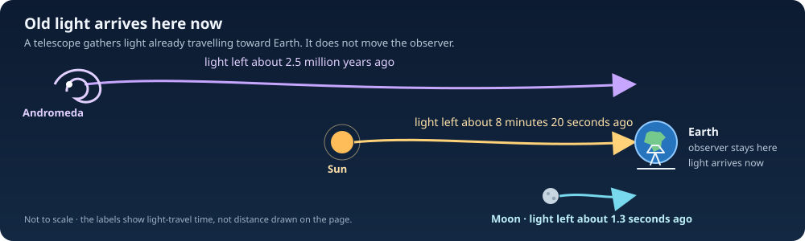
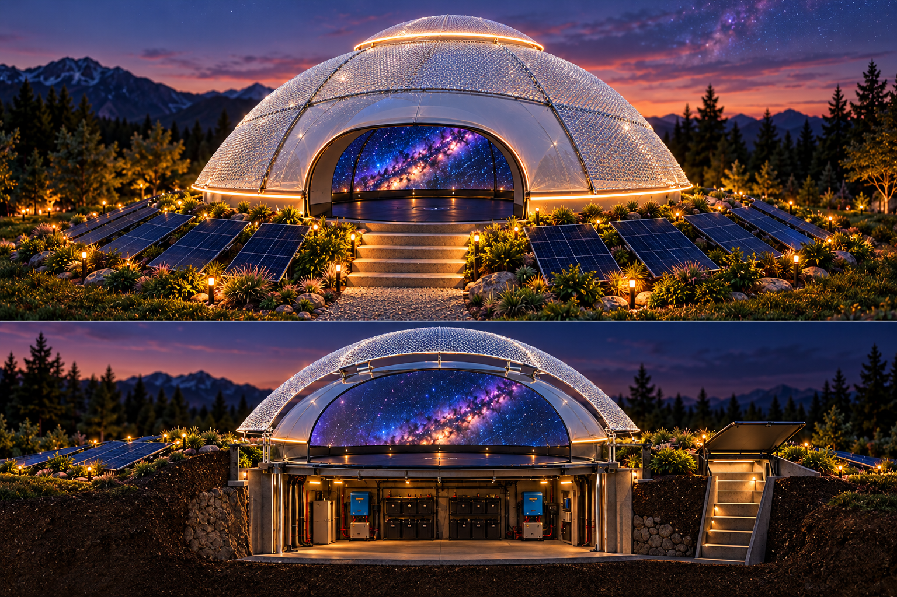

# Travelling Through Space In Time

> **A note on how to read this journey**  
> Let us grant A.R.G.O. one extraordinary instrument: a chronal channel that can link a present mind to a continuous sequence of distant events. We will treat that as a working rule of this science-fiction world and ask what the instrument must do. Its route still has to fit a geometry; its field must carry finite information and energy; its clock maps must be computable; and its signal must survive noise, gravity, and feedback. We can explore the new law with confidence while keeping the familiar physics and the invented physics legible.

The journey has three ledgers. **Geometry** records where every event lies and whether the signal's path is continuous. **Information** records what scene is encoded, how quickly it is sampled, and how uncertainty grows. **Experience** records how A.R.G.O.'s local crew turns that stream into a moving point of view while their bodies remain at home. Quantum entanglement can give the instrument a shared reference and help compare patterns; the chronal channel is the story's added interaction that makes selected patterns available. None of these ledgers can be replaced by a glowing line on a map, but together they let us calculate a richly imagined voyage.

## A.R.G.O. and the Star of Bethlehem reference mission

## The story in one minute

This is a science-fiction navigation book built with real physics. A.R.G.O. and its crew stay at home, while the crew's experience ranges across events thousands of light-years away. Their onboard clock advances by minutes. In the Bethlehem reference mission, the crew will experience the distant Star event through this connection; the ship and crew remain aboard A.R.G.O. We take that mission as the story's premise, then use equations to calculate what follows, what the known theories can support, and which new law the fiction must add.

*A.R.G.O. stays on Earth while the crew looks outward. The luminous lines are a visual metaphor; they do not show a solved or physically propagating signal.*

To plan the mission, we need more than an old date. Earth moves, and so do the Sun, planets, and Moon. We must say where A.R.G.O. stays, which remote events the crew experiences, how long the crew's clock runs, what observers could see, and how information connects the crew to those events. The vehicle stays on its own worldline; each signal or observation path is modeled separately and continuously.

The story of the Star does not give us an exact date, map location, distance, or path across the sky. We will keep those missing details as questions instead of pretending we know them. The mission is our chosen scenario; the historical text is evidence about what people wrote, not proof that a ship was there.

## The telescope's ordinary look-back

Think of a telescope as a quiet “Zoom through time”: it stays here while light arrives carrying an older picture of the sky. The telescope does not travel into the past; the light simply took a long time to get here.

Astronomy already gives us a friendly kind of “Zoom through time.” A telescope makes a distant object easier to see, but it does not carry us toward it. It collects light that is arriving here now. Because light takes time to travel, the view shows the object as it was when that light began its journey: about 1.3 seconds ago for the Moon, 8 minutes 20 seconds ago for the Sun, and roughly 2.5 million years ago for Andromeda. We look back without leaving Earth. NASA explains this as looking back in time ([Webb](https://science.nasa.gov/mission/webb/science-overview/science-explainers/how-does-webb-see-back-in-time/); [Hubble](https://science.nasa.gov/mission/hubble/science/universe-uncovered/hubble-deep-fields/)).

Here is the lovely twist: when we “Zoom” in on a galaxy, we zoom through space and time in our *view*. The galaxy is not travelling into our room. Its old light is. The telescope catches that light and turns it into a picture: a message from long ago, carried by ordinary light along an ordinary path. We have travelled in what we can see, not in our bodies—and we have received a message, not sent one to the past.

*Old light arrives at one stationary observer. Horizontal lengths are not to scale.*

This is the real inspiration for the mind-journey: the crew can look far away while their bodies stay home. The mission asks for a much bigger connection—to experience a selected event in Earth's past and perhaps make a light visible to a witness there. A telescope's ordinary look-back only receives light that can already reach us; it cannot send information to an earlier event. The proposed A.R.G.O. channel is a separate, unsolved part of the mission.

### A small poem with a large light cone

The sky is not a picture pinned to one moment. It is a stack of messages arriving at once: moonlight a heartbeat old, sunlight eight minutes old, starlight perhaps centuries old, and galaxy light older still. Every telescope points through space, but every telescope also points along a path through time. We call the shape of all the places whose light can reach us our **past light cone**. It is not a tunnel we travel down; it is the set of messages that can meet us here.

So “Zoom” has two honest meanings in this book. First, the real one: magnify a faint patch of sky and receive its ancient light. Second, A.R.G.O.'s imagined one: choose an event-address and let a continuous chronal echo compose a viewpoint from information that ordinary light has not delivered here. The ship stays home in both pictures. In the first, photons do the travelling. In the second, the crew's experience follows a new story-law whose field, energy, bandwidth, and causal rules still have to be written down.

Here is the more adventurous quantum metaphor. Entanglement is a **shared score**: distant instruments can find correlations that are stronger and more delicate than ordinary matching coins. The score helps A.R.G.O. recognize a pattern; it does not carry the melody. In the story, the chronal field is the melody's courier, and the dome is where the crew hears it as a moving sky. If we turn off that invented courier, the shared score remains beautiful—but no past scene arrives on demand. That separation lets us be bold with the fiction and exact about which part is new.

For a child: the universe is a storybook whose pages are events. Starlight lets us read pages whose glowing letters are already on their way to us. Entanglement gives two readers matching bookmarks. A.R.G.O.'s imagined echo is the new rule that lets one reader follow a chosen page continuously. The bookmarks help identify the page; they do not turn into a telephone. That last step belongs to our fiction, and our equations must show what the telephone costs.

**In short:** we are building a navigation plan for a mission that treats time travel as possible. The book is free to imagine new physics; it earns that freedom by stating the new rule, calculating its consequences, and keeping it distinct from results already established in physics.

## A child's guide: what are we trying to do?

Imagine sitting under A.R.G.O.'s starry dome. The ship stays in its garden. Nobody rides a rocket to another galaxy. Instead, the crew chooses a scene in the cosmic story and tries to make a moving picture of it inside the dome. The farther back the scene, the more carefully we must ask: what information makes that picture, and how could it reach us?

We already know one answer. Light is a messenger. Sunlight takes about eight minutes to reach Earth, so when we look at the Sun we see it as it was eight minutes ago. Andromeda's light has travelled for millions of years. A telescope is a kind of time machine for pictures: it lets us see old light, while our feet and clocks stay here.

Now comes the story's big “what if?” Could A.R.G.O. tune in to a scene whose light has not arrived, or let a person's attention sweep across thousands of light-years while only a few minutes pass at home? Our science-fiction answer is the **chronal echo**: an imagined, continuous connection between a chosen event and the crew's experience. It is a story rule, not a discovery about brains or quantum particles. We can still make it scientific in spirit by asking what it would measure, how clear the picture would be, what energy it would need, and whether its path stays smooth.

The child-friendly map below compares the familiar light messenger with the imagined echo. Drag the controls: ordinary light always takes one year per light-year in the simple example, while the echo's required information rate changes with the story's distance and the minutes aboard A.R.G.O. The enormous rate is a measure of the proposed channel's demand—not a photon moving faster than light in ordinary space.

<iframe src="./_static/zoom-through-spacetime.html" title="Interactive Zoom through space and time: ordinary light and the fictional chronal echo" loading="lazy" width="100%" height="1120" style="border:1px solid #28435d;border-radius:8px" allowfullscreen></iframe>

**A rhyme for the route:** *Light brings an old sky into view; the echo is the story's bridge to a view light cannot bring through.* A navigator still has to plot the echo as one continuous information path, keep A.R.G.O.'s own clock moving forward, and label every step that depends on our invented law.

## Mission and navigation requirements

**Mission premise:** A.R.G.O. and its crew remain at a fixed home location while their onboard clock advances by minutes. The crew makes a continuous mental excursion through observations of events thousands of light-years away. For the Bethlehem reference mission, they experience an appearance associated with the Star from the remote observers' point of view. Matter stays home; the model must specify how information creates that experience.
**Status:** Navigation concept and capability gap analysis
**Scope:** Treat the mind-journey as the mission premise. A navigator selects remote events and an information path, then checks the clock mapping, viewpoint, causal consistency, and hazards. Any mechanism that lets experience span light-years in minutes must be stated as an assumption until its physics is specified.

**Vehicle:** A.R.G.O. (Astrarium Research & Galactic Observatory), the saucer-shaped craft that stays at its home location. Its proposed protective bubble is not assumed to transport the hull or crew. Astrarium remains the observatory and navigation software.

*Figure 1. A.R.G.O. concept with the requested Aluminet outer shade layer. The rendering shows the canopy over the dome, with the entrance and solar-panel faces clear. It is an architectural visualization, not a construction drawing or evidence of measured thermal or electromagnetic performance; it does not define the geometry, stress-energy, or operating behavior of a temporal-drive bubble.*

The crew concept also includes a bonded conductive enclosure for electromagnetic compatibility and reflective emergency ponchos as participant apparel; the shielding and radiation limits are specified in the [temporal-drive analysis](temporal-drive-candidate.md).

**Reference mission:** Keep A.R.G.O. at home while the crew experiences the light described in Matthew 2 from the observers' viewpoint, then compare that experience with natural-sky explanations, especially Jupiter. The text does not tell us the exact date, where each observer stood, how far away the light was, or how it moved. We therefore explore scenarios rather than pretending the information path is known.

## What this book does

The mission plan needs a home location, selected remote events, signal routes between them, and a view from Earth that could match the light people described. A.R.G.O.'s clock advances locally while the signal follows its own connected path. Hazard checks apply to both the stationary craft and the signal path.

Astrarium can display a shared sky date, calculate positions for some planets and other objects, draw ordinary space-flight examples, and screen some parts of those paths for close approaches. When its time control runs backward, the program currently plays a regular route in reverse. It does not calculate a ship that physically travels to an earlier date. It has no time-travel engine model, no complete continuous route through a time-travel spacetime, and no full collision check for such a route. Those are work still to do.

The book uses equations and pictures to work through pieces of the challenge. A displayed path is an example until its motion is calculated using a stated physical model. A successful calculation shows what follows from its assumptions; it does not by itself show that a real engine can be built. The software's date range, 3000 BCE to 3000 CE, is the range it can display, not a travel limit found in nature.

## Reference mission: A.R.G.O. will create or observe the Star's appearance

The reference mission reads Matthew 2:1–12 as a sparse historical narrative and asks whether a signal from stationary A.R.G.O. could produce an appearance like the light the text describes. It is not a modern witness report: the text supplies no exact observation date, observer coordinates, angular measurements, range, spectrum, duration, or continuous track. The mission therefore uses candidate epochs and broad observer/viewing regions, with missing quantities left unknown. The passage says the Magi saw a star, traveled from the east, and later saw it go before them and stand over the place where the child was; whether this describes unusual apparent motion, a conventional celestial sign, literary/theological imagery, or something else is unresolved.

The linked discussion asks at 2:08 whether the Star could have been a UFO. Its answer distinguishes logical possibility from evidential support, then argues that Matthew need not imply extraordinary motion and favors a Jupiter interpretation. Astrarium keeps the mission identity fixed and uses that discussion to motivate comparison with natural-sky reconstructions, especially Jupiter. Candidate astronomical proposals include the 7 BCE Jupiter–Saturn triple conjunction and lunar occultations of Jupiter in 6 BCE; these are scholarly interpretations, not settled identifications.

The proposed mission is for stationary A.R.G.O. to be the source or controller of the light the Magi perceived. A valid signal model must connect the craft, the relevant remote events, and the observers with continuous, causally consistent signal paths; reproduce the apparent motion from the observers' changing viewpoints; and explain any reported standstill without assigning the light a made-up range or altitude. The broad Bethlehem region is a candidate viewing area, not a verified house coordinate. Where the source text does not constrain a state, the solver must expose scenario ranges and show how results change. This is a signal and appearance problem, not a spacecraft intercept.

For this mission, known ephemerides describe where modeled celestial objects were, but do not provide a mechanism for linking A.R.G.O.'s experience to an earlier epoch. A temporal signal model must define its metric, field propagation, causal rules, and mapping from remote events to the crew's local experience. The Star narrative defines the encounter; its missing date and viewing geometry remain explicit uncertainties. Known spacecraft and planetary trajectories are validation datasets, not alternate reference missions. UTC, dynamical ephemeris time, onboard proper time $\tau_A$, and the remote-event label $q$ remain distinct time quantities with explicit transformations.

### Mission constraint: a star that appears to lead and stand still

For the current mission model, A.R.G.O. is a stationary saucer-shaped material hull $\mathcal H$. Its proposed local enclosure or field $\mathcal B$ protects the observatory but does not transport the hull or crew. Any temporal channel carrying the crew's experience or producing a remote appearance is a separate field with its own world-tube, energy, momentum, and interaction rules. A bubble boundary is not automatically a solid surface, and drawing one does not define a metric or temporal-drive law.

### Translating the concept drawing into a vehicle envelope

The drawing labels an outer diameter of 23.7 ft (7.22 m), a 14 ft (4.27 m) trampoline, a 7 ft (2.13 m) total above-grade height, and flexible solar panels rated at 300 W each with a footprint of about 4.86 by 2.30 ft (1.48 by 0.70 m). These are concept dimensions, not a surveyed CAD model. The circular footprint within the outer diameter is about 41.0 m²; the 14 ft central circle occupies about 14.3 m². If the full intervening annulus were available and the labeled 60° entrance sector were excluded, its ideal unobstructed area would be about 22.2 m². At roughly 1.04 m² per panel, that area could fit at most 21 panel footprints, or about 6.3 kW of nameplate capacity before spacing, access, curvature, orientation, shading, wiring, and equipment reduce it. The image does not specify an actual panel count or site-specific energy yield.

For site safety, the outer 23.7 ft diameter is only a first horizontal bound. The physical footprint must also include the entrance and steps, support legs, berm, solar-panel edges, rear hatch, and below-grade room; the drawing gives no complete underground depth or structural plan. Until those are measured, terrain and structure clearance remains unknown where the missing dimensions matter. The 300 W panel labels describe ordinary electrical generation; they do not specify or power a temporal channel. The 10 m by 20 m semiaxes used in a separate single-bubble density example are not fitted to this craft or its proposed signal path.

The narrative does not say that the light was a vehicle, that it appeared and disappeared in a modern UFO-report sense, or that it made several passes. If Astrarium models repeated appearances, each must arise from the same continuous field and signal history under the selected causal rules; the renderer cannot spawn duplicates as a substitute for dynamics. Compare each appearance's angular position, brightness, spectrum, and timing with a defined narrative interpretation. No repeat count is supplied by the source.

The reference implementation has two linked parts:

- **Historical-text encounter.** A provenance-backed record of what Matthew 2 says, kept separate from later interpretation. Candidate dates, observer locations, viewing directions, range, and duration are scenario inputs with explicit uncertainty; the software must not present them as measured facts. The encounter model predicts the apparent sky from candidate observer sites and states what optical signature a hypothetical A.R.G.O. manifestation would need to produce.
- **Temporal signal and mind-journey model.** Define the stationary A.R.G.O. worldline, onboard clock, continuous signal/field paths, remote-event sequence experienced by the crew, energy and momentum transport, and causal closure. Keep the model explicit and replaceable; it is a required physics layer, not something Lambert transfers or ephemerides provide.

For the current mission, the crew's proper time $\tau_A$ advances along a stationary A.R.G.O. worldline while their mind-journey is represented by a continuous remote-event map $q(\tau_A)$ and an explicit information/field path. A.R.G.O. must also produce a local optical manifestation at the witness event to be seen as a UFO. The earlier two-bubble traveler scenario instead tracks a test traveler whose exterior epoch may decrease along part of a closed timelike curve; it returns to its departure event and does not model this signal mission. Its equations and limitations are in [Appendix B: Two-bubble traveler model and signal-path alternatives](temporal-drive-candidate.md). Crew disorientation or reluctance to interact remains a story hypothesis, not a consequence of either model.

The lead mission should report whether the Star narrative constrains a unique temporal signal path. It does not: event date, viewing geometry, physical range, and apparent-motion record are missing. The book must show that underdetermination rather than fill it with invented telemetry. Historical trajectory datasets such as Apollo reconstructions can validate frames and interpolation, but do not constrain the Star narrative or establish a UFO interpretation.

Start with a source-and-interpretation ledger for Matthew 2, then implement scenario ranges, sky reconstruction, route constraints, and observer-view prediction. Use source-backed celestial data and known trajectory records to validate epoch conversion, frame transforms, interpolation, and route continuity. Test state estimation, spatial maneuver control, encounter reconstruction, and temporal travel behavior separately so success in one does not imply success in another.

The Bethlehem mission is the book's central mind-journey: keep A.R.G.O. at home, reconstruct candidate skies and observer views at an uncertain ancient epoch, then ask what continuous information path and visible manifestation would be required. Competing natural-sky interpretations remain visible in the same analysis. The mission premise defines the experience and appearance to explain; it does not substitute for a physical channel model or a hazard-checked field path.

(physical-status-and-continuity)=
## 1. Physical status and the continuity requirement

This proposal separates three claims that are easy to conflate:

1. **Ordinary relativistic time dilation is established physics.** A traveler can accumulate less proper time than observers on a chosen reference worldline and still move toward their future. This does not provide a route into an earlier Earth epoch.
2. **General relativity admits mathematical spacetimes with closed timelike curves (CTCs), subject to global and physical caveats.** A CTC is a continuous timelike worldline that returns to an event in its own causal past. A signal that reaches a past event also needs causal structure that allows the relevant pastward connection. Such solutions are not evidence that a usable channel can be built. Proposed constructions can require unusual stress-energy or assumptions whose physical realizability is unsettled. Hawking's chronology-protection conjecture argues that quantum effects may prevent macroscopic chronology violation; it is a conjecture, not a proved universal theorem.
3. **Astrarium's mind-journey is a mission postulate.** The software may explore it as a conditional model, but must not describe the postulate as a consequence of ephemerides, a solved GR signal path, or demonstrated neurophysics.

Use signature $(-+++)$. A.R.G.O.'s material hull follows a timelike curve $z_A^\mu(\tau_A)$ parameterized by its onboard proper time, satisfying

$$
g_{\mu\nu}(z_A)\,\frac{dz_A^\mu}{d\tau_A}\frac{dz_A^\nu}{d\tau_A}=-c^2.
$$

For the mission configuration, $\mathbf{x}_A$ is fixed in the selected local frame and $\tau_A$ increases continuously. The field or information path is a separate curve $y^\mu(\lambda)$. For freely propagating light, its tangent is null, $g_{\mu\nu}(dy^\mu/d\lambda)(dy^\nu/d\lambda)=0$, with affine parameter $\lambda$; it has no onboard proper time. A coordinate label changing toward an earlier date is physical only if the causal structure and field solution permit the signal to connect those events. Relabeling coordinates or drawing a smooth curve cannot change causal order.

For simulation, distinguish four things: the hull event $z_A^\mu(\tau_A)$, the signal event $y^\mu(\lambda)$, the remote event epoch $q(\tau_A)$ represented in the crew's experience, and the witness event where a visible photon is received. A decreasing $q$ is a desired description of the mind-journey; it is not by itself a physical drive law. The model still needs a field equation, a continuous signal solution, a source and energy budget, a clock map, and rules for interactions and causality.

A moving-mouth traversable wormhole is mentioned as one conditional way a signal might take a shorter path while A.R.G.O. stays home. This book has not solved a wormhole signal route or its clock matching. The separate two-bubble traveler comparison and its equations are in [Appendix B](temporal-drive-candidate.md); they do not provide the signal shortcut required by the mission.

**Continuity axiom.** Every material, signal, or field path must be one connected curve on a single parameter interval, with continuous event and tangent at joins. A.R.G.O.'s hull state and clock remain continuous along $z_A(\tau_A)$; a light/field path remains continuous along $y(\lambda)$. The remote-event map $q(\tau_A)$ must be continuous and agree with the endpoint events reached by the solved channel. It cannot be an arbitrary interpolation through epochs unsupported by the metric and field dynamics. No path may jump between dates or splice disconnected samples and call them one journey.

The continuity axiom is necessary but not sufficient for navigation. Check the signal/field path against matter and metric structure at the same spacetime events, and separately check A.R.G.O.'s stationary site envelope. A visible appearance additionally requires a signal reaching the witness and a calculated local optical signature. Propagate uncertainty in the metric, field, source, event dates, and observation geometry. If the causal model or field solution is unspecified, both reachability and clearance remain unknown.

### The mind-journey: local clock, remote viewpoint

The crew's bodies and clock stay aboard A.R.G.O.; their conscious viewpoint follows a modeled sequence of remote observations. In this mission premise, that sequence is the journey. The crew lives through it in minutes of onboard time while the viewpoint ranges through distant places and dates. This is a postulate about the experience we want the model to represent, not a claim that consciousness has a known independent trajectory through spacetime.

The diagram offers three ways to keep the pieces straight: a 2D sky view, a 3D map of locations, and a 4D spacetime view that adds time. Its slider moves through an illustrative sequence of remote events. The dotted connection is marked unsolved because no physical channel has yet been calculated.

  <iframe src="./_static/mind-journey-map.html" title="Interactive 2D, 3D, and 4D mind-journey illustration" loading="lazy" allowfullscreen width="100%" height="1000" style="border:1px solid #28435d;border-radius:8px"></iframe>

In flat spacetime, a light signal from 1,000 light-years away arrives after about 1,000 years on clocks at rest with the endpoints. A photon's path has zero proper time, but this does not make the receiver's wait zero. Therefore the desired experience—minutes for the local crew while their viewpoint follows distant events—requires a new information path or spacetime geometry, not ordinary light propagation.

Model three things independently:

1. **A.R.G.O. worldline:** the craft remains at its home location; its proper time $\tau_A$ advances normally.
2. **Signal paths:** outgoing and incoming information follow continuous null curves in the selected metric. A one-way signal can show or announce a distant event; communication or interaction needs a return channel too.
3. **Remote viewpoint:** the crew's experience is indexed to observations associated with a distant event. The model must specify what information reaches them and how that information shapes perception; a remote viewpoint does not move their bodies from A.R.G.O.

For remote events separated by exterior distance $D$, define $\Delta\tau_A$ as the onboard time over which the crew experiences the linked observations. The requirement $D=1{,}000$ light-years and $\Delta\tau_A=5$ minutes is a target for the chosen information model, not a locally measured photon speed. The 1,000-light-year separation is a separate navigation scale; it is not the distance from A.R.G.O. to the Bethlehem witnesses. Any sighting date must add the ordinary light-travel time from the historical emitter to each witness after the signal exits its time-shifted path. The simulator must return the remote event sequence, signal paths, local clock interval, viewpoint mapping, and uncertainty. A traversable wormhole is a clear hypothetical shortcut for information while the ship remains outside; a warp metric or accessible extra-dimensional channel would require its own field equations and source assumptions. Dark matter does not presently provide such a channel. Ordinary curved-space light propagation still follows the causal structure of its metric; a drawing or time slider cannot stand in for that model. {ref}`Appendix B section 3.1 <stationary-ship-optical-channel>` now works through a conditional stationary-ship wormhole signal: it calculates a smooth mouth-clock offset, then separates that kinematic input from the still-unsolved throat metric, optical path, and crew-experience map.

### The mind's-eye Zoom: a poem with a physics engine underneath

When you Zoom into a galaxy, your body stays in the room. Your eyes receive light that left long ago, and your brain builds a view from those arriving photons. The farther the galaxy, the older the light in the picture. In that sense, looking far away is also looking back.

Now imagine A.R.G.O. has a much stranger instrument: a **mind's-eye Zoom**. Its bowl-shaped dome becomes a listening room for patterns in spacetime. A child navigator chooses an event like a page in a cosmic atlas. The room does not fly there. Instead, in our story, a new kind of field lets the crew's shared point of view follow a continuous trail of information to that page, then onward through neighboring pages. A.R.G.O.'s clock ticks for minutes while the chosen scenes may be separated by thousands of light-years.

This is poetic physics: the picture is vivid, and the equations must still pay rent. Ordinary telescope-Zoom is real: old light travels to us inside our past light cone. The mind's-eye Zoom is the fictional extension: it must explain how information is selected, carried, decoded, and kept continuous without the crew or ship moving. Its navigation plot therefore has two tracks: the local clock aboard A.R.G.O. and the remote-event address being experienced.

> **A gentle rule for readers:** a map can point to a faraway page, but pointing is not traveling. A telescope receives the page's old light. A.R.G.O.'s imagined chronal echo is the extra rule that would let the mind's eye read a page whose light has not reached home.

### A quantum idea: entanglement as a shared score

Could A.R.G.O. and a distant observer share entangled particles, then use the connection to “Zoom” into an earlier scene? Entanglement gives nature a remarkable kind of long-distance partnership: measurements at the two ends can be correlated more strongly than any shared classical coin toss. That makes it an interesting tool for comparing measurements and coordinating a network of quantum sensors.

In standard quantum mechanics, the partnership does not carry a chosen message by itself. Each observer's result is locally random; the pattern becomes visible after they compare records using an ordinary signal. Quantum teleportation also needs classical bits to complete the transfer. The little explorer below plots a spin-singlet pair: changing the distant detector changes the correlation, while A.R.G.O.'s local chance of reading +1 stays at one half. That is the measured-theory baseline for our science-fiction extension.

<iframe src="./_static/entanglement-no-signalling.html" title="Interactive Bell-pair entanglement and chronal-channel calculator" loading="lazy" width="100%" height="2200" style="border:1px solid #28435d;border-radius:8px" allowfullscreen></iframe>

Here is a more adventurous picture. Imagine that every event in the universe leaves a quantum “address”—not a little postcard hidden in space, but a label for which physical state and viewpoint belong together. Entanglement could provide A.R.G.O. with a shared set of reference labels, like two copies of the same index in a library. Changing the label would change which scene the mind's-eye tries to reconstruct. In ordinary quantum theory, the index alone contains no readable story: local outcomes stay random, and the two libraries can compare pages only through an ordinary signal. This is an analogy for the fictional design, not a known property of entangled particles.

The science-fiction leap is to give the universe a new kind of **chronal echo**. In the story, A.R.G.O. does not pull a person or a spacecraft through the sky. Its resonators tune a query to an event-address; a continuous field path carries the selected pattern; and a neural decoder turns that pattern into a lived point of view. Entanglement is the shared score that lets the query and decoder recognize matching patterns. The echo is the imagined channel that carries them. It reaches an earlier event only because the story adds new causal physics; entanglement alone cannot open that route.

There is a poetic way to hold the idea: the telescope receives an old sentence written in light; entanglement gives two readers matching bookmarks; the chronal echo is the fictional rule that lets one reader ask the page a question. The image is useful as long as we remember where the metaphor ends. A bookmark is not a message, and a correlation is not a tunnel. In the imagined instrument, Zoom has three steps: choose an event-address, follow the echo's continuous information path, then decode the arriving pattern as a scene. Only the second step is the impossible new channel; the first is navigation, and the third is a fictional model of perception.

**What would count as new physics?** In standard quantum mechanics, the reduced state aboard A.R.G.O. cannot be changed into a controllable message by choosing a measurement on a distant entangled partner. The crew's local detector statistics stay the same until records are compared over an ordinary channel. A working chronal Zoom would need a changed, testable rule: for example, a small, repeatable, selectable change in local detector statistics that carries a decoded event label before any ordinary message arrives. That would violate the standard no-signalling prediction, so it must be stated as a new law with a quantitative signal, noise, energy, and causality budget—not attributed to entanglement alone. Quantum teleportation likewise needs classical communication to complete the protocol. [The American Physical Society's overview of no-signalling](https://physics.aps.org/story/v15/st22) summarizes why faster-than-light messaging is excluded in the standard framework.

We can state that leap compactly. Let $|q\rangle_X$ label a remote event and $|\tau\rangle_A$ label an A.R.G.O. clock reading. The fictional query device applies a kernel

$$
\langle q|\mathcal C_s|\tau\rangle_A=\eta\,G_{\sigma_q}\!\left(q-q_0-sR(\tau-\tau_0)\right),\qquad q(\tau)=q_0+sR(\tau-\tau_0),\quad s\in\{-1,+1\}.
$$

This says which remote event contributes to each moment of the crew's experience, how blurry the selection is, and how much signal survives. The sign $s=-1$ gives reverse-ordered playback; $s=+1$ gives a rapid chronological scan of the selected interval. The underlying entangled state can correlate the query and its decoder; it cannot supply the operator $\mathcal C_s$. That operator is the invented physics. A full theory must derive it from a continuous field path, preserve energy and momentum, specify what information is available at the remote event, and close the quantum state consistently if the path loops through its own causal past. A.R.G.O. can then “Zoom” by changing the event address: like a telescope, its viewpoint samples old scenes; unlike a telescope, the fictional query rule reaches scenes whose light could not yet have arrived.

This distinction gives the story a clean experimental signature. If the chronal query rule is turned off, A.R.G.O.'s local detector statistics must return to the ordinary no-signalling pattern shown above. If it is turned on, the new signal must carry a measurable payload, have a finite bandwidth and timing blur, and produce the same decoded scene when independent crew members use calibrated receivers. A correlation that appears only after ordinary records are compared is not a chronal message. A correlation available locally before comparison would be a dramatic new law—and an unmistakable departure from standard quantum mechanics. The entangled state is our shared score; the invented channel is the orchestra that makes it audible. In the book's navigation language, “Zoom” is the operation of selecting and decoding a remote event-address. Ordinary astronomy zooms by collecting ancient light that has already reached us; A.R.G.O.'s fictional zoom would add the chronal echo needed to select a scene beyond that ordinary light cone.

### Quantum links as coordinates, not spacecraft

We can push the quantum idea further without asking entanglement to do a job it cannot do. Imagine a network of quantum sensors distributed through the fictional bulk, each sharing entangled pairs with A.R.G.O. Their correlations could provide matching coordinate marks: when local records are eventually compared, they could help identify which sensors sampled related field modes and reconstruct the network geometry. For a bipartite state $\rho_{AB}$, the quantum mutual information is

$$
I(A{:}B)=S(\rho_A)+S(\rho_B)-S(\rho_{AB}),\qquad S(\rho)=-\mathrm{Tr}(\rho\log_2\rho).
$$

It measures correlations, not a message sent from $A$ to $B$. A Bell pair has $I(A{:}B)=2$ bits, but neither side can choose its random measurement result to encode a word. The pair is like two beautifully correlated dice, not a faster-than-light telephone. Quantum teleportation does not change this: the receiver needs classical bits before the state can be reconstructed ([Bennett et al., 1993](https://doi.org/10.1103/PhysRevLett.70.1895)).

The science-fiction engineering leap is to use changes in the *pattern of correlations* as a probe of hidden geometry. Let $C_{ij}=\langle\sigma_i\otimes\sigma_j\rangle$ be the measured correlation between sensors $i$ and $j$. A chronal medium might have a response kernel $K(q,\tau)$ between A.R.G.O.'s clock reading $\tau$ and remote-event label $q$. The network could then be modeled by

$$
C_{ij}(\tau)=\int dq\;K(q,\tau)\,G_{ij}(q)+\epsilon_{ij}(\tau),
$$

where $G_{ij}(q)$ is the correlation pattern predicted for the network at event $q$, and $\epsilon_{ij}$ collects detector noise and model error. Here $q$ is a dimensionless event coordinate, and the kernel is normalized so $\int K(q,\tau)\,dq=\eta$, with $0\leq\eta\leq1$ the response efficiency. This is an inverse problem: infer the kernel from measurements. Mutual information alone is not a distance meter; a geometry reconstruction needs an independently specified rule connecting field correlations to spacetime geometry. In standard physics, this equation is a data-analysis model only when the records can be compared through ordinary causal channels. The fictional extension says that the chronal medium makes a selected remote pattern locally available in minutes. It must provide its own dynamics, bandwidth, noise floor, energy source, and backreaction; no known entanglement protocol supplies them.

Why might this feel like a journey of mind? Imagine the dome receives reconstructed field patterns one after another. A neural or computer display turns them into a moving viewpoint, just as a planetarium turns many measurements into a coherent sky. The crew experiences motion through a scene while the hull remains still. Continuity belongs to the sequence of decoded views; coordinates belong to the inferred geometry; the ship's worldline remains local. This is a useful science-fiction design, but it does not make the crew, consciousness, or information physically travel unless the new kernel is a propagating channel in the story's field equations.

The test is concrete. With the chronal coupling off, local measurements must obey ordinary no-signalling: changing a distant measurement setting cannot change A.R.G.O.'s reduced density matrix $\rho_A$. With it on, the model predicts a selectable shift $\delta p(a\mid x)$ in local outcome probabilities before ordinary records arrive. Its size must exceed stated noise and detector drift, with a specified dependence on distance, event-label separation, and coupling strength. If there is no such local signature, the entangled network can still help reconstruct a map afterward—but it has not become the engine of a minutes-long journey through light-years.

One more possibility is that the network transmits no *scene* at all. It may instead change which histories are compatible at a boundary, rather as post-selection changes conditional probabilities in carefully selected laboratory data. A.R.G.O. could act as a “history interferometer,” comparing candidate event histories and registering those that match a chosen boundary condition. This is mathematically suggestive, but post-selection alone cannot choose a rare outcome on demand or create a closed timelike curve. The story must add a controllable boundary-condition mechanism and account for its success probability, entropy, and causal consistency. Here the chronal echo is the proposed channel; entangled sensors and boundary selection are ways the fictional instrument addresses and decodes it.

### A two-boundary quantum telescope: letting the future help frame the past

There is a stranger way to use quantum theory in the story. Ordinary prediction starts with a prepared state and asks what may happen next. Quantum experiments can also ask a conditional question: if a system was prepared in one state and later found in another, what can we infer about an intervening measurement? This is called **pre- and post-selection**. It makes the future measurement part of the description of the past without sending a message backward in time. The Aharonov–Bergmann–Lebowitz rule gives the conditional probability for an intermediate outcome $a$:

$$
P(a\mid\psi_i,\psi_f)=\frac{|\langle\psi_f|\Pi_a|\psi_i\rangle|^2}{\sum_b|\langle\psi_f|\Pi_b|\psi_i\rangle|^2},
$$

where $|\psi_i\rangle$ is the prepared state, $\langle\psi_f|$ describes the later selected result, and $\Pi_a$ projects onto the outcome being tested. This is a rule for updating probabilities when both ends of an experiment are specified. It does not let an experimenter choose the later result at will, and it does not make the earlier detector's statistics carry a controllable message. [The original time-symmetric measurement paper](https://journals.aps.org/pr/abstract/10.1103/PhysRev.134.B1410) develops this conditional framework.

For A.R.G.O., imagine an **event-address register** entangled with a receiver inside the dome. The register has basis states $|q\rangle$, each tagged to a candidate event in the sky's history. A conventional telescope estimates $q$ from photons that have already arrived. The fictional telescope instead asks whether a boundary condition at A.R.G.O. can select one event-address from a continuous family, while an echo field supplies the missing physical connection. The entanglement is the matching key: it helps the receiver recognize which pattern belongs with which event. The field is still the courier.

Here is the sharp science-fiction hinge. In standard quantum mechanics, a later boundary condition can change a *conditional description* of earlier results, but it cannot be turned into a knob that changes earlier local statistics. The story adds a new **chronal susceptibility** $\chi(q,\tau)$: a coupling between the receiver's local clock reading $\tau$ and a remote event label $q$. A simple fictional response kernel is

$$
K_R(q,\tau)=\frac{\eta}{\sqrt{2\pi}\,\sigma_q}\exp\!\left[-\frac{(q-q_0+R(\tau-\tau_0))^2}{2\sigma_q^2}\right],\qquad \int K_R(q,\tau)\,dq=\eta,
$$

so its peak follows $q(\tau)=q_0-R(\tau-\tau_0)$. The parameter $R>0$ is the rate at which the viewed event-label runs toward earlier values; $\sigma_q$ is the blur in that label; and $\eta$ is the surviving response amplitude. The kernel is smooth, so the selected viewpoint has no date-jumps. A possible microscopic story-law would couple event operators through a nonlocal interaction,

$$
S_{\rm chronal}=\hbar g\int d\tau\,dq\;K_R(q,\tau)\,\hat O_A(\tau)\hat O_X(q),
$$

with dimensionless operators $\hat O_A,\hat O_X$ and $g$ carrying the units needed to make the action dimensionless. This equation is not derived from ordinary quantum field theory: $\hat O_X(q)$ at an earlier event cannot influence A.R.G.O. through a standard retarded field in a globally hyperbolic spacetime. The coupling is the invented law that the rest of the fictional theory must earn.

The idea is therefore a **two-boundary quantum telescope**, not “entanglement sends the crew through time.” One boundary helps choose the question; the other records a continuous local experience. A hypothetical chronal susceptibility joins them, and the echo field carries the answer. Turn off $g$ or $\eta$, and A.R.G.O. returns to ordinary quantum statistics: it can look at old light already on its way here, but it cannot query an event outside its causal past light cone. Turn the new law on, and its first testable consequence is a selected change in local outcomes before any ordinary signal could arrive. That would violate standard no-signalling and must come with a numerical signal strength, background noise, energy cost, backreaction, and an account of causal loops. In the story, that violation is the instrument's engine; in real physics, it is the line the engine has crossed.

A child-sized picture: the universe is a book whose pages are events. Entanglement gives two readers matching bookmarks. A future measurement can help us infer which sentence was written earlier, but it cannot whisper the sentence across the room. A.R.G.O.'s fictional chronal field is the impossible whisper—made continuous, measurable, and costly enough that the equations have to keep track of every word.

### A quantum consistency filter: post-selection

There is a more technical quantum idea for deciding which self-referential histories survive. In **post-selected teleportation**, prepare two systems in a maximally entangled state, let one interact with the payload, then keep only trials in which a later measurement finds a chosen entangled outcome. The retained data behave mathematically like a quantum channel conditioned on a future boundary condition. Researchers have used this construction to model closed-timelike-curve behavior and to test its predictions with ordinary laboratory circuits; those experiments simulate the model through selection of measurement records. They do not create a spacetime loop or send a message to yesterday ([Lloyd et al., theory](https://arxiv.org/abs/1007.2615); [Lloyd et al., optical experiment](https://arxiv.org/abs/1005.2219)). This is a competing quantum consistency prescription, not an extra layer on top of the Deutsch rule adopted below for the reference model.

For a $d$-level payload, a particular maximally entangled Bell outcome in ordinary teleportation occurs with probability $1/d^2$ when the interaction is the identity. If the payload is $n$ independent qubits, $d=2^n$, so the chosen outcome occurs with probability

$$
p_{\rm herald}=d^{-2}=4^{-n},\qquad \log_{10}p_{\rm herald}=-n\log_{10}4\simeq-0.60206n.
$$

The selected state can be written as a normalized conditional map,

$$
\rho\longmapsto\frac{C\rho C^\dagger}{\operatorname{Tr}(C\rho C^\dagger)},\qquad C=\operatorname{Tr}_{\rm loop}U,
$$

where $U$ describes the interaction with the loop register. The normalization depends on the input state, which is why the conditional rule is nonlinear. In a real laboratory the rejected trials still exist; one cannot force the desired result to occur on demand. The fictional chronal controller would have to promote this conditional rule into a global law of nature and explain how its success condition is enforced without a controllable post-selection device.

This gives A.R.G.O. a measurable design tension. If we naïvely encoded the book's uncompressed 1080p color stream as one qubit per bit, $n\simeq9.42\times10^{19}$ and the specific-outcome probability would be about $10^{-5.67\times10^{19}}$. That number is not a universal limit on every imaginable quantum channel: a compressed scene, a different interaction, or a different consistency law changes the model. It does show why “entanglement sends the whole picture” is not a useful engineering specification. A.R.G.O. needs a stated scene code, a success rule, an error rate, and a bandwidth budget; if it relies on rare post-selection, its claimed minutes-long excursion must account for the probability that the chronal query simply fails.

Post-selection can therefore serve as a **quantum consistency filter** in the story, while the chronal echo remains the signal path. A quantum circuit or a boundary condition does not by itself draw a continuous route through spacetime. To honor the mission's no-jump rule, every history that survives the filter must still correspond to one connected field solution in the chosen geometry, with continuous events, wave-vector, and stress-energy at each join. The P-CTC prescription is also one choice among inequivalent quantum consistency rules; critics have identified paradoxes in its broader use, so the book must treat it as a candidate rule rather than a settled account of nature ([Ralph's critique](https://arxiv.org/abs/1107.4675)).

### A candidate signal law: the advanced massive-field tail

Here is a second, more sharply defined piece of speculative physics. Give A.R.G.O. a neutral scalar field $\Psi$ obeying a Klein–Gordon equation,

$$
\left(\Box_g-\frac{m_\Psi^2c^2}{\hbar^2}\right)\Psi(x)=J(x).
$$

The equation itself is familiar. Its Green function is not unique until we choose boundary conditions. The retarded Green function lets a source influence its future; the advanced Green function has support in the source's past. Both solve the same local wave equation. Standard physical preparation selects retarded behavior for controllable signals. A.R.G.O.'s science-fiction postulate is a **future-boundary transducer** that can prepare and control an advanced solution:

$$
\Psi_{\rm adv}(x)=\int G_{\rm adv}(x,x')J_A(x')\,dV',\qquad
\operatorname{supp}G_{\rm adv}(\cdot,x')\subseteq J^-(x').
$$

Here $J_A$ must be a finite, smooth source distributed across A.R.G.O.'s world-tube; an ideal point impulse is useful for deriving the Green function, but its singular field is not a realizable transmitter.

This does not make a disturbance outrun light. The field can only connect events inside the causal cone. For a massless field in flat 3+1-dimensional space, the Green function lies on the light cone; for a massive Klein–Gordon field it also has a tail inside the cone. A.R.G.O. and an ancient event on nearly the same terrestrial worldline are timelike separated, so a massive tail is the relevant mathematical feature. In the ordinary retarded problem it carries information from the ancient event toward the later ship. The fiction changes the boundary condition so the later ship participates in selecting the earlier field. That is a real reversal of cause and effect, even though the field equation and its continuous local solutions are familiar. The massive-scalar tail is a standard result; the controllable advanced transducer is not ([Yaremko](https://arxiv.org/abs/1207.5002)).

**Causal-path audit.** An advanced Green function is a boundary-value rule, not a future-directed worldline running from A.R.G.O. to the ancient event. In a globally hyperbolic spacetime, no continuous future-directed causal curve connects a later event $S$ to an earlier event $X$. A smooth field value at both events does not supply that missing curve. To meet the mission's no-jump navigation requirement, either embed the field in an explicit chronology-violating geometry and integrate its continuous path through that geometry, or keep the advanced solution labeled as a nonlocal causal postulate rather than a traveled route. If A.R.G.O.'s present setting is supposed to choose the past flash, solve the complete future-boundary problem—including the field's return, the light seen by witnesses, and a self-consistency rule—before claiming controllable signaling. This is the decisive difference between a mathematically allowed advanced solution and an operational time-drive.

The mass scale is not arbitrary if the field is meant to remain coherent across a long timelike separation. The tail's phase depends on the dimensionless quantity $m_\Psi c^2\Delta\tau/\hbar$. Setting that quantity to order one for $\Delta\tau=2{,}000$ Julian years gives

$$
m_\Psi\sim\frac{\hbar}{c^2\Delta\tau}=1.86\times10^{-62}\,\mathrm{kg},\qquad
\frac{m_\Psi c^2}{1\,\mathrm{eV}}\sim1.04\times10^{-26},\qquad
\bar\lambda_\Psi=\frac{\hbar}{m_\Psi c}\sim2{,}000\,\mathrm{ly}.
$$

This is a characteristic phase scale, not a derived particle mass, a measured dark-matter candidate, or proof that a usable signal survives. It says that a field whose Compton clock ticks much faster than the two-millennia separation will accumulate a rapidly varying phase across the historical link. Its tail strength, bandwidth, noise, coupling to matter, and stability still have to be calculated.

To couple the field to light, one candidate is the gauge-invariant interaction $\mathcal L_{\rm int}=-(g_{\gamma\Psi}/4)\Psi F_{\mu\nu}F^{\mu\nu}$ in natural units. It changes the electromagnetic kinetic term and must be varied together with the scalar and source action; the derived equations are given below. A static $\Psi$ with no charged current leaves $F_{\mu\nu}=0$ as a solution, so this coupling is not by itself a light bulb. Photon production needs a physical time-dependent pump or charged emitter, and the field, resonator, emitter, and photons must exchange a conserved total stress-energy. A visible pattern also requires finite source size, directionality, and spectrum; the coupling alone specifies none of those.

The energy scale makes this separation essential. For the 2,000-year phase choice above, one scalar quantum at rest carries $m_\Psi c^2\simeq1.67\times10^{-45}\,\mathrm J=1.04\times10^{-26}\,\mathrm{eV}$, corresponding to $m_\Psi c^2/h\simeq2.52\times10^{-12}\,\mathrm{Hz}$. A 550 nm photon carries about $2.25\,\mathrm{eV}$ at $5.45\times10^{14}\,\mathrm{Hz}$—roughly $2.2\times10^{26}$ times more energy per quantum. This ultralight field can be a slowly varying control or phase field; it cannot be treated as a one-quantum visible-light source. A conversion model would need to tap an enormous coherent field population or, more plausibly, trigger a separate powered emitter at the past event, then show where that emitter's energy comes from. For scale, the point-source scenario in [Appendix B](temporal-drive-candidate.md) uses 22 mJ of visible output and 2.2 J at A.R.G.O. under a 1% assumed channel efficiency. Supplying 22 mJ from these scalar quanta alone would require at least $1.3\times10^{43}$ quanta even at perfect energy conversion; real coupling losses raise the requirement. This count is an energy bookkeeping bound, not evidence that such a coherent state or coupling can be prepared.

There is a useful hard limit. A fixed advanced link between two worldlines gives a time offset, approximately $q=\tau_A-\Delta$, and therefore $dq/d\tau_A=+1$. It can place a single field pulse in an earlier era, but it does not make later control pulses touch progressively earlier scenes. The required reverse-playback map $dq/d\tau_A<0$ still needs an orientation-reversing boundary operator or a different global geometry. This candidate therefore offers a testable field-equation template for one pastward interaction, not a solved manifestation or the entire mind-journey. Its key new rule is controllability of an advanced boundary condition; it must not be hidden inside the word “entanglement.”

**Route choice for the rest of this chapter.** The advanced massive-field solution above is a boundary-condition alternative: it does not provide a future-directed path from A.R.G.O. to the past. The reference science-fiction architecture below instead uses a continuous field route in a chronology-violating five-dimensional bulk. Those are competing ways to alter the causal story, not two parts of one solved engine. The moving-mouth wormhole remains a separate general-relativity comparison, and the two-bubble model remains a test-traveler comparison. None supplies the required five-dimensional source or the reverse-playback map by itself.

### A.R.G.O.'s proposed quantum drive: an entangled chronal echo

Now let the science fiction begin. A.R.G.O. carries two matched quantum resonators whose fields are prepared in a two-mode squeezed state,

$$
|\Psi(r,\phi)\rangle=\frac{1}{\cosh r}\sum_{n=0}^{\infty}(e^{i\phi}\tanh r)^n|n\rangle_A|n\rangle_B,\qquad \bar n=\sinh^2 r.
$$

The parameter $r$ sets the shared excitation level and $\phi$ sets the relative phase. In the fictional drive, a controlled interaction $H_{\rm int}(t)=g(t)\,\hat O_A(t)\hat O_B(t)$ couples the resonators, in spirit like the boundary interaction in the Gao–Jafferis–Wall construction. A.R.G.O.'s compact resonators are not those boundary theories; the interaction is a design postulate that must be given a microscopic Hamiltonian and energy budget. Entanglement helps prepare and read the channel; it is not the channel and cannot send a chosen message by itself. The reference architecture assumes a chronology-violating five-dimensional bulk geometry that supports the field route; it does **not** assume that entanglement creates a traversable throat. A wormhole-like throat could be one geometric ingredient, but then its stress-energy and clock map must be solved separately. A.R.G.O. and its crew stay home. A low-energy information-bearing field follows the bulk route continuously, and a local neural interface turns the arriving field into a lived remote viewpoint.

There is a real mathematical seed for this device. In a particular theoretical setting, Gao, Jafferis, and Wall showed that coupling two boundaries of an entangled black-hole system can create negative averaged null energy and make an Einstein–Rosen bridge traversable. A.R.G.O. extends that result to compact resonators and a useful signal channel; neither extension follows from the paper. The boundary coupling is essential in the mathematical example—entanglement alone does not open the passage. [ER=EPR](https://arxiv.org/abs/1306.0533) inspires the geometry; [the traversable-wormhole construction](https://arxiv.org/abs/1608.05687) inspires the control interaction.

### A more ambitious quantum doorway: entangle, open, time-shift

Here is a bolder design for the story. Do not ask a Bell pair to whisper across the universe. Ask a vast entangled quantum system to help define the *shape of the route*, then use a controlled interaction to open that route briefly. A.R.G.O. would be a clock, control room, and viewpoint decoder; the moving part of the design would be the geometry and the information-bearing field.

In the most studied theoretical sketch, the two sides begin in a thermofield-double-like state,

$$
|\mathrm{TFD}\rangle=Z^{-1/2}\sum_n e^{-\beta E_n/2}|n\rangle_L|n\rangle_R,
$$

where $L$ and $R$ label two quantum systems, $E_n$ are their energy levels, $\beta=1/(k_B T)$ is inverse temperature, and $Z$ normalizes the state. The proposed control is an interaction between the sides,

$$
H_{\rm link}(t)=g(t)\sum_a \hat O_L^{(a)}\hat O_R^{(a)}.
$$

With dimensionless $\hat O_L$ and $\hat O_R$, $g(t)$ has units of energy; a microscopic model must say what supplies that work and where the control field's stress-energy goes.

In the specialized holographic model, this coupling changes the quantum stress near the Einstein–Rosen bridge. The important quantity is the averaged null energy along a ray with tangent $k^\mu$,

$$
\mathcal A=\int d\lambda\,\langle T_{\mu\nu}\rangle k^\mu k^\nu.
$$

The Gao–Jafferis–Wall construction makes $\mathcal A<0$ for its chosen interaction and state; the gravitational response can then let a signal cross a bridge that was previously non-traversable. In semiclassical gravity the backreaction belongs in

$$
G_{\mu\nu}+\Lambda g_{\mu\nu}=\frac{8\pi G}{c^4}\langle T_{\mu\nu}^{\rm total}\rangle_{\rm ren}.
$$

This is the exciting science seed: quantum information changes a stress tensor, the stress tensor changes geometry, and the geometry changes which signals can pass. It is not “entanglement is a tunnel.” The bridge in the ER=EPR conjecture is ordinarily non-traversable; the extra interaction is what opens the theoretical example. [Gao, Jafferis, and Wall](https://arxiv.org/abs/1608.05687) derive this in a particular anti-de Sitter black-hole setting, not for a garden-sized saucer. Their setup does not violate causality. A.R.G.O.'s pastward mouth clock would be another, separate step. A 2022 quantum-processor experiment reproduced selected dynamics of a simplified holographic model with a nine-qubit circuit; it did not create a wormhole in space or send a signal through one ([Nature](https://doi.org/10.1038/s41586-022-05424-3)).

For A.R.G.O., make the speculative extrapolation explicit: replace the two little resonators with a large, strongly interacting quantum network whose effective geometry has two mouths. The ship-side mouth sits beside the stationary dome. The target-side mouth lies near a chosen historical Earth observer. The story's new law says that the prepared quantum state encodes the geometric connection; a smooth control pulse $g(t)$ opens a finite window; a low-energy probe or data field takes a continuous path through the throat; and an independently powered source at the target mouth emits the visible flash. The witness sees ordinary future-directed photons. If the crew wants to see the witness's view, a second field path returns measurements to A.R.G.O. The entangled state can help establish the shared code and timing reference, but each leg still needs a physical channel.

The new ingredient that makes this *time* travel is a clock offset, not entanglement. Let $\Delta_{\rm past}$ be the earlier-than-present shift produced by the two mouth histories, $\delta_{\rm th}$ the finite throat transit contribution, and $T_{\rm ext}$ the travel time needed for a specified causal return to the entry mouth. The geometry must deliver

$$
\Delta_{\rm eff}=\Delta_{\rm past}-\delta_{\rm th}>T_{\rm ext},
$$

with a margin larger than timing and route uncertainty if the story needs a robust closed loop. This is the loop test derived in [Appendix B](temporal-drive-candidate.md). A traversable throat alone moves information between mouths; it does not make either mouth historical. A time-shifted throat can give one earlier appearance, but an ordinary equal-clock map still preserves the order of signals. A five-minute scan across 5,000 years needs the extra transfer law $|dq/d\tau_A|\simeq 5.26\times10^8$ as well as the past offset. No known entanglement protocol supplies that factor.

There is also an information bill. As a deliberately extravagant benchmark, imagine reconstructing 5,000 years of uncompressed 1920×1080, 24-bit RGB video at 30 frames per source second. That is $4.73\times10^{12}$ frames, about $2.94\times10^{19}$ bytes (29.4 exabytes), compressed into five minutes at about $98$ petabytes per second. The onboard interval between frame addresses is only about 63 picoseconds. Human perception does not require a full video archive; a sparse description of a few lights could be vastly smaller. But quantum correlations do not erase the information requirement: the channel must carry enough distinguishable states to support whichever view the crew is promised.

For scale, ideal superdense coding can encode two classical bits in one transmitted qubit when the receiver already shares a Bell pair with the sender. Even granting that ideal protocol, the raw-video benchmark would require at least $3.9\times10^{17}$ transmitted qubits per second. The qubit still has to travel through a channel, and the shared pair must be prepared and preserved; pre-shared entanglement alone carries no chosen message ([Bennett and Wiesner](https://doi.org/10.1103/PhysRevLett.69.2881)). A practical story can lower this requirement by sending event markers—“five lights here, moving south, this brightness”—instead of a movie, but it must say what details are discarded and how the returned view is reconstructed.

The doorway has four gauges for the navigator: entanglement fidelity (does the shared state survive?), averaged null energy (does the gate-opening interaction have the required sign and duration?), loop margin (does the time-shifted route close?), and channel capacity (does enough information arrive before the gate shuts?). Low entanglement fidelity raises decoding errors or demands costly error correction; the wrong null-energy pulse leaves the bridge shut; a failed loop test means the chosen causal return does not close; and insufficient capacity yields a blurred or incomplete scene. This chain gives quantum theory a real job in the fiction while preserving the hard boundary: the published holographic results do not supply a compact, stable, Earth-scale time machine.

In the book's language: entanglement writes the score, the controlled negative-energy pulse lifts the bridge, the clock offset points its far end toward an older scene, and ordinary light makes the scene visible.

The most speculative sentence in the design is also its clearest research question: **can a controllable entangled quantum network source enough negative averaged null energy to open a finite throat, then change the throat's clock map by billions while keeping the field state coherent and the loop self-consistent?** The story's answer can be yes. Its calculation must still solve the geometry, source, quantum channel, and witness image together.

The key speculative step is not a device that flips time like a film reel. It is a spacetime with a continuous **chronal echo**: the signal always advances along its local future direction, while the chosen Earth-time coordinate decreases along part of its route. In ordinary globally ordered spacetime, no such route exists. In a spacetime containing a closed timelike curve (CTC), a future-directed signal can return to an event in its own past. The crew's proper time $\tau_A$ still advances. The remote event label $q$ can decrease only because the signal path passes through a region where this coordinate is not a global clock.

#### Separate temporal magnification from time reversal

Let $T_A$ be the crew's mission duration and $\Delta Q$ the interval of remote history to be sampled, both in the same units. A simple event-selection law is

$$
q(\tau_A)=q_0+sR(\tau_A-\tau_0),\qquad R=\frac{\Delta Q}{T_A}>0,\qquad s\in\{-1,+1\}.
$$

The book's original choice $s=-1$ asks for more than the mission needs if the goal is to *view an interval of the past in order*: a later onboard sample corresponds to an earlier remote event. That reverses the order of scene markers and, for a directly transferred wave, reverses the sign of its phase frequency. Choosing $s=+1$ instead scans from an ancient event toward a later one. By choosing the interval endpoints to remain before the crew's present, the scenes stay historical while appearing in their ordinary chronological order.

Choose $q_0$ at an ancient event and let $q$ advance through a historical interval. The crew can then experience that interval at high speed while the selected events remain in their ordinary chronological order; this is a map between event labels and the crew's experience, not a claim that people in the remote history feel their clocks speed up. For a 5,000-year interval sampled in five onboard minutes, $R=5.2596\times10^8$ remote seconds per crew second. One nanosecond of onboard timing uncertainty becomes 0.526 seconds in the reconstructed history; 30 samples per remote second would require about 63.4 picoseconds between onboard samples. If the signal's phase is directly reparameterized, a 550 nm optical carrier would map to roughly 1.04 MHz (about 289 m wavelength), so a visible appearance still needs a powered optical emitter at the historical event rather than merely relabeling the crew's carrier.

This is a useful comparison, not a free physical shortcut. Laboratory **time lenses** can magnify or compress a photon wavepacket's time coordinate using dispersive propagation and nonlinear optics, and quantum time lenses can reshape temporal modes. They operate on fields already present in the apparatus; they do not let a laboratory select an arbitrary remote spacetime event or send a signal to it ([quantum temporal imaging](https://arxiv.org/abs/1704.00279)). A moving-mouth wormhole also produces a Lorentz-factor relation between *exterior coordinate times*, but that is not automatically a pastward scan. Suppose A is stationary and B is the clock-lagging mouth. Equal-clock matching gives $d\tau_A=d\tau_B$. While B coasts, $d\tau_B=dq_B/\gamma$, so the stationary-to-moving map has $dq_B/d\tau_A=\gamma$; with B lagging, that A-to-B crossing exits on B's future side. The pastward crossing is B-to-A. When indexed by the crew's proper clock at the lagging mouth, its ideal map to the stationary mouth is $T_A=s_B+C$, hence $dT_A/ds_B=1$. A fixed clock lag changes the exit epoch but leaves a five-minute input spanning five minutes at the exit.

For the 5,000-year/five-minute example, the *coordinate-time comparator* would need $\gamma=R=5.2596\times10^8$, or $1-v/c\simeq1/(2\gamma^2)=1.81\times10^{-18}$. During the corresponding 5,000-year exterior interval, a coasting mouth travels almost 5,000 light-years. Its special-relativistic kinetic energy is $E_k=(\gamma-1)mc^2\simeq4.73\times10^{25}$ joules per kilogram of mouth mass; this omits the wormhole's own mass, formation energy, and support fields. These numbers characterize the *wrong-direction coordinate stretch* in the standard clock-lag setup; they do not establish the needed pastward mind-scan. A path that brings the mouth back to the witness region also needs a solved, hazard-checked worldline. To map five minutes of the lagging mouth's proper time onto 5,000 years of past source proper time, the throat transfer itself needs a varying offset $h(s_B)$ with $dh/ds_B\approx R-1\approx5.2596\times10^8-1$. The ordinary twin-paradox offset is constant and supplies no such term. The positive scan remains a boundary condition for new, time-dependent throat physics, not a result of ordinary relativistic time dilation.

For a single sighting, the least demanding target may be neither a 5,000-year scan nor reverse playback: it may be one finite source event, with a short interval of witness time and a specified return record. The mission should compare those three payloads—single flash, forward scan across old events, and reverse-ordered scan—because each imposes a different timing map, frequency law, data rate, and consistency condition. The scene controls should expose the choice rather than quietly build one into the word “time travel.”

Either choice of $s$ is only a boundary condition on the chronal echo, not a reverse-time switch or a signal path. It tells the field solver which remote events the crew should experience; it does not solve the field equations or prove a route exists. The gravitational source must include the complete device, field, electromagnetic radiation, emitter, and brane material—not only $\Psi$. The reference model therefore uses a 5D bulk field coupled to 4D source and optical degrees of freedom on a brane; its action and junction equations appear below. In a four-dimensional effective description, the corresponding shorthand would be $G_{\mu\nu}+\Lambda g_{\mu\nu}=(8\pi G/c^4)\langle T_{\mu\nu}^{\rm total}\rangle_{\rm ren}$, with all components included.

In an ordinary globally hyperbolic region, a retarded Green function $G_{\rm ret}(x,x')$ maps a source pulse $J(x')$ to a received field $\Psi(x)=\int G_{\rm ret}(x,x')J(x')\,dV'$, with support only along causal paths to the future. A chronology-violating spacetime may not have a well-posed global initial-value problem or a unique retarded Green function. A.R.G.O.'s model must therefore supply field boundary conditions and a self-consistency rule at its chronology horizon before the signal is computable. Work on quantum fields at compactly generated Cauchy horizons shows that the usual Hadamard-state construction can fail there; this is a serious stability and predictivity challenge, not a detail the story can skip. [Kay, Radzikowski, and Wald's analysis](https://arxiv.org/abs/gr-qc/9603012). Quantum entanglement may set boundary correlations or help prepare the source state, but cannot put an earlier event inside the field's support by itself. The exterior return time and past offset must also close a loop with a safe margin as described in [Appendix B](temporal-drive-candidate.md).

One useful geometric starting point is the Morris–Thorne metric for a static, spherical wormhole,

$$
ds^2=-e^{2\Phi(r)}c^2dt^2+\frac{dr^2}{1-b(r)/r}+r^2d\Omega^2.
$$

For a simple zero-redshift example, choose $\Phi=0$ and $b(r)=r_0^2/r$, where $r_0$ is the throat radius. In units where $c=G=1$, the Einstein equations give $\epsilon=b'/(8\pi r^2)$ and $p_r=-b/(8\pi r^3)$. Substituting this shape function and restoring SI units gives, in the static orthonormal frame, $\epsilon(r)=-c^4r_0^2/(8\pi G r^4)$ and $p_r(r)=-c^4r_0^2/(8\pi G r^4)$. At the throat, $\epsilon+p_r=-c^4/(4\pi G r_0^2)<0$: the null energy condition is violated. For a one-metre throat, $\epsilon(r_0)\simeq-4.8\times10^{42}\,\mathrm{J/m^3}$, with $|\epsilon+p_r|\simeq9.6\times10^{42}\,\mathrm{J/m^3}$. This is an actual calculation for a deliberately simple, static geometry, not an A.R.G.O. engine design and not yet a time machine; a suitable mouth history and global causal structure would have to be added to create a CTC. The embedded calculator shows how the required local density scale changes with throat size. Quantum-field constraints make macroscopic, long-lived negative-energy arrangements extremely difficult; the familiar traversable-wormhole results do not establish a practical source. [Morris and Thorne's traversable-wormhole analysis](https://doi.org/10.1119/1.15620) lays out the geometry; [Ford and Roman's quantum-field constraints](https://journals.aps.org/prd/abstract/10.1103/PhysRevD.53.5496) show why a macroscopic throat is a severe burden.

There is a second, stricter gap: the direction of the moving-mouth map matters. Let $T_A$ be exterior time at stationary mouth A and $q_B$ exterior time along moving mouth B. For an ideal equal-clock throat, the same mouth-clock reading labels the matched events. Differentiating the clock readings gives

$$
\left.\frac{dq_B}{dT_A}\right|_{A\to B}=\frac{1}{\sqrt{1-\frac{v_B^2(q_B)}{c^2}}}=\gamma_B>0,\qquad
\left.\frac{dT_A}{dq_B}\right|_{B\to A}=\sqrt{1-\frac{v_B^2(q_B)}{c^2}}=\frac{1}{\gamma_B}>0.
$$

The first derivative is an exterior-coordinate stretch from A to B. If B is the lagging mouth in the standard twin-paradox construction, that crossing maps A's event to B's future. The pastward B-to-A crossing instead maps the lagging mouth's *proper time* $s_B$ to $T_A=s_B+C$, with unit slope. A large clock lag can therefore shift a pulse into the past while preserving send order; it cannot turn five minutes of onboard time into 5,000 years of past source-clock time. The same orientation issue applies when the two mouth labels are exchanged: the lagging mouth must be the entry end for the pastward crossing.

A.R.G.O.'s requested scan needs an additional, explicitly time-dependent throat transfer or other new causal structure. It must produce the desired event map while remaining future-directed locally, and its field solution must carry the signal through the complete CTC and return consistently. A chronal echo is the name for this missing spacetime-and-field solution, not a claim that entanglement or phase conjugation reverses causality.

For one scalar sensory signal $s(q)$ indexed by remote event time, a simple finite-bandwidth channel can be written

$$
s_A(\tau_A)=\int K(\tau_A,q)s(q)\,dq,\qquad
K(\tau_A,q)=\eta\,G_{\sigma_q}\!\left(q-q(\tau_A)\right),
$$

where $G_{\sigma_q}$ is a normalized response kernel of remote-time width $\sigma_q$ and $0\le\eta\le1$ is the channel amplitude efficiency. In the ideal narrow-kernel limit, the output samples the remote record at $q(\tau_A)$. A real version must calculate $K$ from the metric, field, resonator coupling, and decoder; the Gaussian kernel is only a tractable noise model. Clock jitter $\sigma_\tau$ contributes remote-event uncertainty $\sigma_{q,\rm clock}\simeq R\sigma_\tau$, where $R=\Delta Q/T_A$. For a historical sighting, that uncertainty must be smaller than the time resolution of the event being reconstructed. In the 2,000-year/five-minute example, $R\simeq2.10\times10^8$: a 1 ns onboard timing error becomes about 0.21 s in the remote timeline. Preserving 30-fps frame order requires resolving crew-time intervals of about 0.16 ns per source frame, with timing jitter comfortably below that.

The complete mission needs a two-way channel and a separate visible-light leg. In compact form, its event chain is

$$
\text{A.R.G.O. at }\tau\;\xrightarrow{K_{A\to X}}\;X(q)
\;\xrightarrow{\text{ordinary future-directed light}}\;O
\quad\text{and}\quad
X(q)\;\xrightarrow{K_{X\to A}}\;\text{A.R.G.O. at }\tau'.
$$

The first kernel delivers a control or probe field to the selected historical event $X(q)$; there it produces the proposed optical pattern and sends observation data back through the second kernel. Every arrow must have a continuous path in the same spacetime model. The Bell pair supplies neither kernel by itself. If the two kernels and the observer light form a causal loop, their outputs must satisfy the chosen CTC consistency rule, as well as energy, momentum, and collision constraints.

The earlier-event output is a sequence of records from progressively earlier events, not a microscopic reversal of every quantum state. The neural interface must decode the arriving field continuously without requiring the crew's neurons themselves to execute a reversed microscopic history.

A useful reference payload is an uncompressed 1920×1080, 24-bit color image at 30 frames per remote second, plus 48 kHz, 16-bit stereo audio. These are familiar media formats, not required biological vision specifications. Compression and sparse/event descriptions can reduce the payload, but the required scene information and acceptable losses must be specified rather than assumed away.

In A.R.G.O.'s fictional operating model, quantum entanglement is the **shared correlation resource**, a calibrated clock network supplies timing references, negative-energy stress supports the **transport geometry**, the chronal echo is the **continuous field path**, and a neural interface turns the arriving signal into experience. Those are separate parts of one device. Entangled correlations are experimentally established. Traversable throats have mathematical models in specialized settings. The compact source, controlled time displacement, chronal-echo field, and neural decoder are the story's new physics. Entanglement can help compare quantum measurements but does not synchronize clocks by itself or send information to the past.

The quantum state must also be consistent around any closed causal loop. For the reference model in this chapter, choose Deutsch's fixed-point condition: if $\rho_C$ is the state returning along the closed curve, $\rho_R$ is the ordinary forward-time input, and $U$ is their interaction, require

$$
\rho_C=\operatorname{Tr}_R\!\left[U(\rho_R\otimes\rho_C)U^\dagger\right].
$$

Once a fixed point is selected, the corresponding forward-time output is

$$
\rho_R'=\operatorname{Tr}_C\!\left[U(\rho_R\otimes\rho_C)U^\dagger\right].
$$

For a one-bit “grandfather” toy loop restricted to classical computational-basis mixtures, a flip gives $p=1-p$, so the only fixed distribution is $p=1/2$. The full quantum channel is different. If the loop qubit undergoes the Pauli flip $X$, then $\Phi(\rho_C)=X\rho_CX$. Writing $\rho_C=(I+xX+yY+zZ)/2$ gives $(x,y,z)\mapsto(x,-y,-z)$, so every density matrix

$$
\rho_C(x)=\frac{I+xX}{2},\qquad -1\leq x\leq1,
$$

is a fixed point. The classical 50/50 mixture $I/2$ is the special case $x=0$, but the pure states $|+\rangle$ and $|-\rangle$ are fixed too. If the CTC rule only says “choose a fixed point,” the loop qubit's state is not unique; in a larger drive where that state interacts with an outgoing payload, the ambiguity may affect the predicted output. The interactive line below shows this family and the measurement statistics that distinguish its members. This illustrates the role of the Deutsch consistency equation; it does not build a loop or prove that nature uses the rule. More generally, the fixed point can depend on the forward input, yielding an effective nonlinear map for the ordinary system. And even a uniquely selected density matrix would not specify the spacetime path, the field's arrival event, or a controllable message to the past. [Deutsch's original quantum closed-timelike-line model](https://journals.aps.org/prd/abstract/10.1103/PhysRevD.44.3197).

One explicit way to remove the degeneracy in this toy example is to add a replacement-noise channel,

$$
\Phi_\epsilon(\rho)=(1-\epsilon)X\rho X+\epsilon\frac{I}{2},\qquad
(x,y,z)\mapsto((1-\epsilon)x,-(1-\epsilon)y,-(1-\epsilon)z).
$$

For any $0<\epsilon\leq1$, its only fixed point is $I/2$. But an $x$-axis coherence used to encode a scene marker is reduced to $(1-\epsilon)^n x$ after $n$ loop passes. This is a concrete state-selection-versus-signal-retention tradeoff: the extra noise can select one state in the toy map while erasing information carried by that state. A real resonator would need a microscopic environment, energy/entropy accounting, and a coupling to the five-dimensional field; the slider is not a derivation of those ingredients.

<iframe src="./_static/deutsch-fixed-point.html" title="Interactive Bloch-vector view of Deutsch fixed points for a qubit flip" loading="lazy" width="100%" height="510" style="border:1px solid #28435d;border-radius:8px" allowfullscreen></iframe>

The model still owes us four hard calculations: the resonators' stress-energy and its backreaction on the selected five-dimensional geometry (including a throat's source and clock map only if that geometry uses one); a global field propagator with boundary conditions and stability through the chronology horizon; the bandwidth, timing noise, and energy needed to carry the information; and a neural transfer function that creates a lived viewpoint without discontinuities or destructive stimulation.

### The new law in the story: a loop-coupled chronal echo

To make the science fiction precise, give A.R.G.O. a field whose **response kernel itself loops through the chronology-violating region**. Entanglement does not send the field. A local phase-locked resonator pair supplies the beat and correlated calibration; a new topology-sensitive interaction couples its modes to a bulk echo field on the assumed five-dimensional chronology-violating geometry. Picture it as a musical score: the resonators keep the beat, while the fictional spacetime route carries the notes to an earlier bar. The beat helps compare the signal; it is not the courier. A wormhole-like throat could be one ingredient in the bulk geometry, but this reference model does not require one. The interaction, its stress-energy, and its ability to reach the past are fictional postulates. The known traversable-wormhole result by Gao, Jafferis, and Wall is a mathematical seed involving a boundary-coupling protocol in a specialized black-hole setting; it does not establish this compact resonator or this chronology channel ([paper](https://arxiv.org/abs/1608.05687)).

Let $a(\tau_A)$ be A.R.G.O.'s complex control envelope, and let $q$ label remote event time in seconds. For a mission that samples earlier dates as the crew clock advances, set

$$
q(\tau_A)=q_0-R(\tau_A-\tau_0),\qquad R=\frac{\Delta Q}{T_A}>0.
$$

A wave-level check follows if $q$ is calibrated to proper seconds at the past emitter and the channel directly carries phase. For $a_A(\tau_A)=A e^{-i2\pi\nu_A\tau_A}$, the affine map gives $|\nu_X|=\nu_A/R$ at the historical end: a 550 nm optical carrier would become about 2.59 MHz, or a wavelength near 116 m, for this $R$. The sign of the complex frequency also reverses under naive composition; a field theory must specify how positive-frequency modes are identified and whether conjugation or Bogoliubov mode mixing occurs. A visible UFO pattern therefore needs a target-side optical oscillator and energy supply, unless the new channel derives another frequency-conversion law. The compact-support kernel below models event-time blur, not the carrier passband, which remains unspecified.

#### Quantum carrier and energy audit

If the sign reversal is implemented as phase conjugation of a quantum optical mode, it matters for the mode algebra. A bosonic mode has annihilation and creation operators with $[a,a^\dagger]=1$. A literal one-mode conjugation, $b=a^\dagger$, would give $[b,b^\dagger]=-1$; it cannot be the output mode of a physical quantum channel. A canonical phase-conjugating conversion must include another degree of freedom, usually an idler mode. A simple two-mode Bogoliubov transformation is

$$
b=\cosh r\,a+e^{i\phi}\sinh r\,c^\dagger,\qquad d=\cosh r\,c+e^{i\phi}\sinh r\,a^\dagger,
$$

which preserves $[b,b^\dagger]=[d,d^\dagger]=1$. Even when both inputs are vacuum, the output contains $\langle b^\dagger b\rangle=\sinh^2 r$ quanta. The drive pump supplies that energy and the idler carries correlated noise; it cannot be omitted from the source and backreaction budget. This is the familiar bookkeeping of parametric quantum amplification, applied here as a constraint on the proposed temporal transducer ([Caves, 1982](https://doi.org/10.1103/PhysRevD.26.1817)). It does not show that a chronal transducer exists.

The scale is severe. Mapping 2,000 years of event time into 300 seconds gives $R\simeq2.10\times10^8$. A 550 nm phase-coherent carrier at $\nu_A\simeq5.45\times10^{14}$ Hz would map to $|\nu_X|=\nu_A/R\simeq2.59$ MHz, with the negative sign indicating reversed phase orientation under the naive map. A 2.59 MHz carrier is radio, not visible light. One option in the story is to send a low-frequency event code and let a powered emitter at the historical end paint the visible manifestation. For $N_{\rm vis}$ photons at 550 nm, that emitter must supply at least

$$
E_{\rm vis}=N_{\rm vis}\frac{hc}{550\,{\rm nm}}\simeq N_{\rm vis}(3.61\times10^{-19}\,{\rm J}),
$$

before conversion losses. The other option is to transport a phase-coherent optical state; then the full mode-conversion law, idler, pump work, added noise, and stress-energy must be derived. Entanglement may correlate the signal and idler or calibrate the event code, but it does not pay this energy bill or transmit the code without the chronal field. The historical brightness and duration are not constrained by Matthew's text, so $N_{\rm vis}$ must remain a scenario input rather than an invented mission measurement.

The story's proposed transfer law is a finite-width, compact-support chronal transfer kernel,

$$
K_{\rm echo}(q,\tau_A)=\eta\sqrt R\,G_{\sigma_q}\!\left(q-q_0+R(\tau_A-\tau_0)\right),\qquad
\Psi_X(q)=\int K_{\rm echo}(q,\tau_A)a(\tau_A)\,d\tau_A,
$$

with $\sigma_q=R\sigma_A$ and a smooth, compact-support response

$$
G_\sigma(x)=\frac{C}{\sigma}\begin{cases}\exp\!\left[-\dfrac{1}{1-(x/\sigma)^2}\right],&|x|<\sigma,\\0,&|x|\ge\sigma,\end{cases}\qquad C^{-1}=\int_{-1}^{1}\exp\!\left[-\frac{1}{1-u^2}\right]du.
$$

This bump is infinitely differentiable and exactly zero outside $|x|<\sigma_q$ ($C\approx2.25228$): a finite onboard control interval of duration $\Delta\tau$ maps to a remote support width $R\Delta\tau+2\sigma_q$, with no tails implying effects at every date. The $\sqrt R$ prefactor makes the ideal zero-width map $a(\tau_A)\mapsto a(\tau_A(q))/\sqrt R$ preserve the mathematical one-dimensional envelope norm $\int|a|^2d\tau_A=\int|\Psi_X|^2dq$ when $\eta=1$. This is not a claim of physical energy or photon-number conservation. Under this chosen normalization, matching a unit output envelope amplitude requires an input amplitude gain $\sqrt R/\eta$, or a normalized squared-envelope gain $R/\eta^2$. The actual energy flux depends on carrier-frequency conversion, group velocity, throat modes, and gravitational backreaction, and must come from the solved stress tensor. The kernel's peak moves continuously to earlier $q$; its width sets how sharply the drive can select a historical event. This negative slope is not supplied by the ordinary moving-mouth calculation elsewhere in the book: its ideal equal-clock rule is $T_B=s+C$, so $dT_B/ds=+1$. That clock offset can conditionally shift a single pulse into an earlier era while keeping pulses in send order; it cannot generate this reverse-ordered, 2,000-year playback. The echo needs a different global causal geometry and transfer map. The compact-support response is a **postulated law**, not a transfer kernel derived from Maxwell or Klein–Gordon theory on an ordinary metric. Locally, the echo field could obey $(\Box_g-\mu_\Psi^2)\Psi=J_{\rm res}$, but the negative-slope matching rule is the new law. The kernel compresses the required input-output behavior; a realization must replace it with one connected field solution whose local characteristic is future-directed and whose event, field, and wave-vector match continuously at every join. In a globally hyperbolic spacetime, ordinary retarded propagation cannot carry a chosen signal into its own past. A.R.G.O. needs a new geometry and field theory that derive this matching, remain finite at the chronology horizon, and obey $G_{\mu\nu}+\Lambda g_{\mu\nu}=(8\pi G/c^4)(T_{\mu\nu}^{\rm ordinary}+\langle T_{\mu\nu}^{\Psi}\rangle+T_{\mu\nu}^{\rm device})$ together with $\nabla_\mu T_{\rm total}^{\mu\nu}=0$. Semiclassical field theory already faces a serious obstruction at some compactly generated Cauchy horizons ([Kay, Radzikowski, and Wald](https://arxiv.org/abs/gr-qc/9603012)); the fictional kernel must say what replaces that failed description.

**A possible extra-dimensional courier (story model).** Add one spatial bulk coordinate $w$ and let A.R.G.O. and the historical optical source live on a four-dimensional brane embedded in a five-dimensional spacetime $(\mathcal M_5,G_{AB})$. A bulk scalar field $\Psi$ couples to a resonator current $J_A$ near A.R.G.O. and to an optical-emitter current $J_X$ at the remote event. In the simplest linear toy theory,

$$
\text{(in natural units }c=\hbar=1\text{)}\qquad
(\Box_5-\mu_\Psi^2)\Psi(X)=J_A(X)+J_X(X),\qquad
H(q,\tau_A)=g_Ag_X\,G^{(5)}_{\rm ret}\!\left[X(q),A(\tau_A)\right],
$$

so that $H$ is the propagation kernel the earlier chronal rule merely assumed. The field returned to the emitter would be $\Psi_X(q)=\int H(q,\tau_A)a(\tau_A)\,d\tau_A$. In an ordinary globally hyperbolic bulk, the retarded Green function vanishes unless $X(q)$ lies in the causal future of $A(\tau_A)$; therefore an earlier Earth event receives no chosen signal and $H=0$ there. Making $H$ nonzero for the desired past event requires the bulk geometry or its boundary conditions to contain a chronology-violating route. An extra dimension by itself is not that route, and entanglement cannot replace the Green function.

**Flat-bulk causality check.** Give the extra dimension every ordinary advantage: take a flat five-dimensional metric with one time and four spatial dimensions,

$$
ds_5^2=-c^2dt^2+d\mathbf{x}^2+dw^2.
$$

For endpoints separated by brane distance $D=|\Delta\mathbf{x}|$ and bulk displacement $\Delta w$, any future-directed null or timelike signal must satisfy

$$
c\,\Delta t\geq\sqrt{D^2+(\Delta w)^2},\qquad \Delta t>0.
$$

The extra coordinate increases the required travel distance; it never makes the straight flat-bulk route faster. For A.R.G.O. at rest in this flat frame, five minutes of ship time permits at most $cT_A=8.99\times10^{10}\,\mathrm m\approx0.601$ AU of null travel. A target 1,000 light-years away requires at least 1,000 years of future coordinate time even when $\Delta w=0$, about $1.05\times10^8$ times longer than five minutes. If the target event is earlier than the control event, $\Delta t<0$ and the future-directed condition fails outright. This calculation rules out the simple “take a shortcut through an ordinary extra dimension” idea. The selected fiction must instead specify a curved bulk with a genuine chronology-violating causal path (or change the causal law itself); it cannot obtain the result from dimensionality alone.

The interactive panel below lets readers vary $D$, $|\Delta w|$, the selected past-event age, and A.R.G.O.'s clock interval. It computes the flat-bulk null travel-time floor and displays the pastward no-go result separately from that distance scale.

#### An exact global-topology test: the helical Misner quotient

The flat-bulk check says what *doesn't* work. To test a genuine closed route without pretending to have built a drive, use a five-dimensional extension of Misner spacetime. Let $T$ and $\psi$ be dimensionless coordinates, $\mathbf{x}\in\mathbb R^3$, and $L$ a length scale. In the covering space, take

$$
dS^2=L^2\left(-2\,dT\,d\psi-T\,d\psi^2\right)+d\mathbf{x}^2,
$$

then impose the global identification

$$
(T,\psi,\mathbf{x})\sim(T,\psi+2\pi,\mathbf{x}+\mathbf D).
$$

This metric is locally flat: the route's unusual behavior comes from how the spacetime is stitched together globally. Consider the continuous path in the covering space

$$
T=T_0,\qquad \psi=\lambda,\qquad \mathbf{x}=\mathbf{x}_0+\frac{\lambda}{2\pi}\mathbf D,\qquad 0\le\lambda\le2\pi.
$$

Its endpoint is identified with its start. The tangent has squared norm

$$
g(\dot\gamma,\dot\gamma)=-L^2T_0+\frac{D^2}{4\pi^2},
$$

so this particular loop is timelike when $T_0>D^2/(4\pi^2L^2)$. Its elapsed proper time is

$$
\Delta\tau=\frac{2\pi}{c}\sqrt{L^2T_0-\frac{D^2}{4\pi^2}}.
$$

The route is continuous across the quotient seam; no position or state is teleported. But it is an accelerated path, not a free-fall geodesic. For a 1,000-light-year helical shift and 300 seconds of path proper time, the toy requires $\gamma\approx1.05\times10^8$ and proper acceleration $a=\pi\sqrt{D^2+(c\Delta\tau)^2}/\Delta\tau^2\approx3.3\times10^{14}\,\mathrm{m\,s^{-2}}$ (about $3.4\times10^{13}g$). The interactive calculator varies the displacement, duration, and metric scale and plots this acceleration cost.

This is a useful unit test for a continuous-route solver: it has an explicit metric, a precise endpoint identification, a timelike condition, a clock integral, and a measurable acceleration demand. It is **not** an Earth-history trajectory. $T$ is not a calendar date; the quotient is a global boundary condition rather than a finite field generated around A.R.G.O.; and the model has no 4D Earth brane, witness worldline, target-side emitter, or observed-light fit. Nor does a closed timelike curve by itself select a unique quantum state or guarantee that fields stay finite at the chronology horizon. Misner spacetime is a classic chronology-horizon example, and perturbations of its horizon are unstable in analyzed families of nearby solutions ([Denaro and Dotti](https://arxiv.org/abs/1505.01092)). The helical extension below is a mathematical test geometry, not a proposed engine.

<iframe src="./_static/misner-quotient.html" title="Interactive continuous closed-timelike-curve path in a helical Misner quotient" loading="lazy" width="100%" height="1180" style="border:1px solid #28435d;border-radius:8px" allowfullscreen></iframe>

The science-fiction extension can now be stated as a concrete research problem: choose a five-dimensional metric and brane embedding; solve the bulk-plus-brane field equations; compute the retarded or loop-consistent Green function; and test whether its peak traces $q(\tau_A)$ with the required slope, finite bandwidth, and stable amplitude. The corresponding gravitational equation is schematically $\mathcal G^{(5)}_{AB}+\Lambda_5G_{AB}=\kappa_5^2(T^{\rm bulk}_{AB}+T^{\rm brane}_{AB})$, where $\mathcal G^{(5)}_{AB}$ is the Einstein tensor of the bulk metric $G_{AB}$, with junction conditions where the branes meet or source the bulk. The sources must be conserved, and the resulting stress-energy must remain finite and satisfy the chosen quantum-consistency rule at the chronology horizon. Deutsch's fixed-point condition constrains a quantum state on a loop; it does not supply boundary data for $\Psi$ or guarantee that a finite Green function exists at the chronology horizon. The field equation needs its own boundary/regularity prescription, and that prescription must agree with the global geometry and quantum-state closure. This model is deliberately more specific than saying “dark matter” or “another dimension,” but it has not solved the source, stability, or causality problems; if the bulk remains globally hyperbolic, its pastward response is still zero.

### Minimal bulk–brane action and the conservation ledger

The equations need one shared source model. In natural units ($c=\hbar=1$), take a five-dimensional bulk $(\mathcal M_5,G_{AB})$ with a four-dimensional brane $\Sigma$, induced metric $g_{\mu\nu}$, and bulk scalar $\Psi_5$. Let $\Psi_\Sigma$ be its value on the brane, $F_{\mu\nu}$ the brane electromagnetic field, $\chi_A$ A.R.G.O.'s driven resonator coordinate, and $\mathcal L_{\rm matter}$ include the historical optical emitter, its energy store, and its target polarization mode:

$$
\begin{aligned}
S={}&\int_{\mathcal M_5}d^5X\sqrt{-G}\left[\frac{R_5-2\Lambda_5}{2\kappa_5^2}-\frac12\nabla_A\Psi_5\nabla^A\Psi_5-\frac12\mu_5^2\Psi_5^2\right]\\
&+\int_\Sigma d^4x\sqrt{-g}\left[-\lambda-\frac14(1+g_{\gamma\Psi}\Psi_\Sigma)F_{\mu\nu}F^{\mu\nu}+\mathcal L_{\rm res}(\chi_A)-g_r\chi_A\Psi_\Sigma+\mathcal L_{\rm matter}\right].
\end{aligned}
$$

Here $\lambda$ is the brane tension. The brane delta distribution $\delta_\Sigma$ is normalized by $\int_{\mathcal M_5}\sqrt{-G}\,\delta_\Sigma f=\int_\Sigma\sqrt{-g}\,f$. To make the historical radiator in the preceding section part of this *same* source model, expand $\mathcal L_{\rm matter}$ to include a target polarization mode $\chi_X$ with smooth compact support $w_X(x)$, normalized over its rest-frame spatial volume, and the terms

$$
\mathcal L_{\rm matter}\supset -\frac12\nabla_\mu\chi_X\nabla^\mu\chi_X-\frac12\omega_X^2\chi_X^2-g_Xw_X\chi_X\Psi_\Sigma-\frac12P_X^{\mu\nu}(\chi_X)F_{\mu\nu}+\mathcal L_{\rm charges+reservoir+environment}.
$$

The support $w_X$ follows the historical source world-tube; it is not an apparatus present at A.R.G.O.'s current date. The coupling constants carry the dimensions required by the chosen field normalizations. Varying the combined action gives the local bulk and brane field equations

$$
(\Box_5-\mu_5^2)\Psi_5=\delta_\Sigma\left(g_r\chi_A+g_Xw_X\chi_X+\frac{g_{\gamma\Psi}}4F_{\mu\nu}F^{\mu\nu}\right),\qquad
\nabla_\mu\!\left[Z F^{\mu\nu}+P_X^{\mu\nu}\right]=J_{\rm free}^{\nu},\qquad Z=1+g_{\gamma\Psi}\Psi_\Sigma.
$$

The target oscillator equation includes both chronal drive and electromagnetic back-reaction,

$$
(\Box_4-\omega_X^2)\chi_X=g_Xw_X\Psi_\Sigma+\frac12\frac{\partial P_X^{\mu\nu}}{\partial\chi_X}F_{\mu\nu}+J_{\rm env}.
$$

Here $J_{\rm env}$ represents explicitly modeled material and reservoir degrees of freedom; phenomenological damping alone would hide energy transfer. The Maxwell source $J_{\rm free}^{\nu}$ likewise comes from dynamical charged matter, not an unexplained external current. The effective gauge-kinetic coefficient must stay positive, $Z>0$, or the electromagnetic kinetic term changes sign. Classically, $F_{\mu\nu}=0$ remains a solution with no charged current and no seed: the coupling alone does not draw a chosen picture. A time-dependent $Z$ can parametrically produce photon pairs in the quantum field, but their pump energy, mode distribution, and noise must be included in the same stress-energy balance.

The local mode equation shows what “time-dependent drive” requires. In a source-free, flat brane patch with spatially uniform $Z(t)=1+g_{\gamma\Psi}\Psi_\Sigma(t)>0$, a transverse Fourier mode obeys $\partial_t(Z\,\partial_t A_k)+Zk^2A_k=0$. Defining $u_k=\sqrt{Z}A_k$ gives

$$
\partial_t^2u_k+\left[k^2-\frac{\partial_t^2\sqrt Z}{\sqrt Z}\right]u_k=0.
$$

A periodic $Z(t)$ can parametrically amplify electromagnetic modes near twice the optical frequency. For $\lambda=550\,\mathrm{nm}$, that pump is about $2\nu_{\rm vis}=1.09\times10^{15}\,\mathrm{Hz}$. If the chosen scalar mass has Compton frequency $\nu_C=m_\Psi c^2/h\simeq2.52\times10^{-12}\,\mathrm{Hz}$, then $\nu_{\rm pump}/\nu_C\simeq4.3\times10^{26}$. **This compares the required pump to the assumed mass scale; it does not prove that every solution for $\Psi$ oscillates at $\nu_C$.** For a free massive mode in a flat region, $\omega^2=c^2k^2+(m_\Psi c^2/\hbar)^2$, so higher-frequency modes are mathematically allowed, but their production, transport through the chronology geometry, coupling, and energy cost have not been calculated. The channel's time-map $q(\tau_A)$ is not itself an oscillation frequency and cannot be substituted for $\omega$.

The small-modulation limit makes the optical requirement quantitative. Set $Z(t)=1+\epsilon\cos(\Omega t)$ with $|\epsilon|\ll1$. The transformed mode equation becomes

$$
\ddot u_k+\left[\omega_k^2+\frac{\epsilon\Omega^2}{2}\cos(\Omega t)\right]u_k=0+O(\epsilon^2),\qquad \omega_k=ck.
$$

Near the first parametric resonance $\Omega\simeq2\omega_k$, the ideal lossless mode-amplitude Floquet exponent is approximately $s\simeq |\epsilon|\omega_k/2$ at exact resonance; energy grows as $e^{2st}$ only while the pump remains phase-coherent and depletion and back-reaction are negligible. A finite emitter has losses, finite mode spacing, and a required spatial pattern, so this equation predicts neither the brightness nor a saucer image by itself. The field must supply pump energy at roughly $2h\nu_{\rm vis}$ per created photon pair, and $\chi_X$, the pump, the emitted photons, and the reservoir must satisfy the joint four-momentum ledger. This is one candidate conversion channel, not a completed source design.

There is a further carrier-energy test. Under the calculator's direct phase-following map, a source-side modulation at $\nu_X$ requires an input carrier $\nu_A=R\nu_X$ in magnitude. At 2,000 years into five crew minutes, $R\simeq2.10\times10^8$. For a 550 nm pair-production pump, $\nu_X=2c/\lambda\simeq1.09\times10^{15}\,\mathrm{Hz}$, so direct mapping calls for $\nu_A\simeq2.29\times10^{23}\,\mathrm{Hz}$, or about $0.95\,\mathrm{GeV}$ per input field quantum. The corresponding source-side pump quantum carries only about $4.51\,\mathrm{eV}$. That factor-$R$ energy change per quantum is not explained by the kernel's $\sqrt R$ envelope normalization; the metric, field, resonator, or another explicitly modeled reservoir must account for the energy and momentum exchange. Alternatively, A.R.G.O. could send a low-frequency event code and use a separate target-side optical pump, but that pump's energy still has to arrive at the historical event through a specified channel. The interactive carrier control now displays both scales.

Varying the metric gives the distributional five-dimensional Einstein equation

$$
\mathcal G^{(5)}_{AB}+\Lambda_5G_{AB}=\kappa_5^2\left[T^{(5)}_{AB}+\delta_\Sigma e_A{}^{\mu}e_B{}^{\nu}S_{\mu\nu}\right],
$$

where $\mathcal G^{(5)}_{AB}\equiv R^{(5)}_{AB}-\tfrac12R_5G_{AB}$ is the five-dimensional Einstein tensor and $G_{AB}$ is the five-dimensional metric. The projector $e_A{}^{\mu}$ maps brane directions into the bulk; $T^{(5)}_{AB}$ contains the bulk scalar and any other bulk fields; and $S_{\mu\nu}=-(2/\sqrt{-g})\,\delta S_\Sigma/\delta g^{\mu\nu}$ includes the tension, resonator, electromagnetism, emitter, energy store, and all brane matter. The induced metric is continuous at a thin brane. With $[Q]=Q_+-Q_-$ denoting the jump across its normal, the Israel condition is

$$
[K_{\mu\nu}-Kg_{\mu\nu}]=-\kappa_5^2S_{\mu\nu}.
$$

The brane stress does not conserve separately if the bulk carries momentum across it: its tangential divergence equals the opposing normal–tangential bulk flux, $D_\mu S^{\mu}{}_{\nu}=-[T^{(5)}_{AB}n^Ae^B{}_{\nu}]$ in this jump convention. The distributional total stress-energy, including the bulk, brane and exchange terms, is conserved. These are the standard bookkeeping requirements of a thin-brane field model; the model still has to solve them for its chosen geometry ([Maartens & Koyama, 2010](https://doi.org/10.12942/lrr-2010-5)).

For the target pulse, integrate that local exchange over the emitter world-tube. In an orthonormal frame at the historical source, the four-momentum ledger is

$$
P^\mu_{\rm bulk\to\Sigma}+P^\mu_{\rm pump\to\Sigma}=P^\mu_\gamma+\Delta P^\mu_{\rm device},\qquad P^\mu_\gamma=(E_{\rm emit}/c,\mathbf p_\gamma),
$$

where $\Delta P^\mu_{\rm device}$ is the emitter-plus-reservoir's final minus initial four-momentum. $P_{\rm pump\to\Sigma}$ denotes an independent pump only; if the bulk chronal field itself pumps the target, count that energy in $P^\mu_{\rm bulk\to\Sigma}$ once and set the separate pump contribution to zero. Its photon momentum and isolated recoil are calculated in the interactive sighting budget above. This equation now says exactly what the temporal channel still owes: its integrated energy and momentum flux onto the brane, with no double-counted pump and with the device response included. If the emitter is attached to the ground, include the support and ultimately the Earth in $\Delta P^\mu_{\rm device}$ or model the support impulse explicitly.

This closes the local interaction and conservation bookkeeping, conditional on an already supplied five-dimensional solution. It does **not** generate a chronology-violating geometry, make the retarded Green function nonzero at an earlier event in an ordinary globally hyperbolic bulk, or show that the field stays finite at a chronology horizon. Those remain the actual temporal-drive problem.

To keep repeated echoes from growing without bound, give one resonator mode a loop-consistency law,

$$
a_{n+1}=a_{\rm drive}+g e^{i\phi}a_n,\qquad a_* = \frac{a_{\rm drive}}{1-g e^{i\phi}}.
$$

In this scalar toy model the iteration converges for $|g|<1$; on resonance, the intensity is amplified by $1/(1-|g|)^2$. At $|g|=0.70$ that is an 11.1-fold intensity multiplier. It is a control-system stability rule for the story, **not** a general theorem about closed timelike curves. The book's quantum-state closure is a separate requirement: the field, resonator, and any returning data must also satisfy a chosen CTC consistency rule. A fixed point of a quantum state does not by itself provide the kernel or the path.

At the historical event $X(q)$, the chronal field drives a local optical emitter. In a flat local approximation, a witness at range $D$ receives the light at $t_W=q+D/c$ and measures $F_W\simeq\mathcal T_{\rm atm}P_X/(\Omega D^2)$ for a uniform beam of solid angle $\Omega$. A realistic solution adds the metric's redshift, finite wavefront, atmosphere, terrain, and each observer's worldline. That last leg is ordinary future-directed light. A single point emitter makes a star-like point, not a saucer. For a patterned set of lights, the historical event needs a distributed source; in a simple coherent-aperture model its far-field amplitude is $\mathcal A(\hat{\mathbf n},\omega)=\sum_j a_j(\omega)e^{i(\phi_j-k\hat{\mathbf n}\cdot\mathbf r_j)}$, and each witness sees an intensity proportional to $|\mathcal A|^2/D^2$. The actual aperture positions and phases must reproduce each observer's angular track. Light emission can draw bright edges, but a dark opaque silhouette must scatter or block background light and therefore needs matter or another specified interaction. Either way, compute the source's energy-momentum and its effect on the surrounding atmosphere. This channel does not materialize A.R.G.O.'s opaque hull at Bethlehem.

The resolution requirement is severe. For 2,000 years mapped into five minutes, $R\approx2.10\times10^8$. A 1 ns error in the onboard time coordinate would shift the selected remote event by about 0.21 s. That is a timing-error propagation, not a claim that the clock itself has 0.21 s of random jitter. The interactive model separately displays a 10 ps half-width for its fictional channel kernel; this becomes $\sigma_q=R\sigma_A\approx2.10$ ms on the remote-event axis. Its full support is therefore about 4.21 ms. In the ideal affine map, a control gate of width $10\,\mathrm{s}/R\approx47.53$ ns would have a source support of about 10.0042 s after convolution with this bump. The calculator instead shortens the ideal rectangular control gate to about 47.512 ns so the *full* output support is 10 s; a symmetric response leaves about 9.9958 s between its support edges. This support calculation does not predict the pulse's detailed shape or rise and fall.

Four instantaneous scene markers sent aboard in order $1,2,3,4$ at 158 ps intervals emerge at source events ordered $4,3,2,1$, about 33.3 ms apart. Since the marker separation is about 7.9 times the kernel's full support, the idealized markers remain distinguishable. At fixed range, a later control marker reaches the witness about 33.3 ms earlier; adding the same $D/c$ delay to each event does not change the reversed order. In a flat local frame, the retarded source-to-witness map obeys $dt_W/dt_X=(1+\mathbf n\cdot\mathbf v_X/c)/(1+\mathbf n\cdot\mathbf v_W/c)>0$ for timelike source and witness velocities, with $\mathbf n$ pointing from witness to source. Thus ordinary light preserves chronological order along those worldlines. The roughly 10,000 km range shift that would algebraically cancel one 33.3 ms interval cannot be assigned independently of a causal source and witness trajectory; the full calculation must integrate their retarded null rays.

The control clock also needs calibration against the assumed transfer map. Let the actual rate be $R(1+\epsilon)$ while the controller schedules using $R$. Over a five-minute run the endpoint remote-time error is approximately $\delta q=\epsilon\Delta Q$: at $\Delta Q=2{,}000$ years, a one-part-per-billion rate error accumulates to about 63 seconds, and one part per trillion to about 63 ms. This is not a fundamental clock bound; it is a control tolerance implied by the chosen schedule. The channel model must specify how $R$ is measured, how it drifts, and how the mission re-locks without discontinuously changing the selected event.

An uncompressed 1920×1080×24-bit stream at 30 frames per second for the five-minute crew interval contains $4.48\times10^{11}$ bits and requires $1.49\times10^9$ bit/s (1.49 gigabits/s); a 2,000-year video at that frame rate would contain about $9.42\times10^{19}$ bits. These figures expose an information-rate gap that a time map cannot erase. If A.R.G.O. is to receive every remote frame in 300 seconds, its channel must deliver about

$$
C_{\rm req}=\frac{(1920\cdot1080\cdot24\,\mathrm{bits/frame})(30\,\mathrm{frame/s})(6.31152\times10^{10}\,\mathrm{s})}{300\,\mathrm{s}}\simeq3.14\times10^{17}\,\mathrm{bit/s},
$$

about $2.10\times10^8$ times the rate of the five-minute raw stream. That full remote record has $1.89\times10^{12}$ frames, while the five-minute stream holds only 9,000 raw-frame equivalents: at this deliberately simple encoding, it could sample one frame about every 81 days of the remote interval. This is a payload benchmark, not a claim that human vision needs uncompressed video. A compact event code could be much smaller, but its encoder must say which motion, color, sound, and context it preserves. Once the channel has bandwidth $B$ and signal-to-noise ratio $S/N$, the classical noisy-channel bound $C\le B\log_2(1+S/N)$ gives the next engineering check ([Shannon, 1948](https://doi.org/10.1002/j.1538-7305.1948.tb01338.x)). Entanglement does not add classical capacity on its own; standard teleportation still needs its classical feed-forward bits. The fictional chronal channel must specify its own bandwidth, noise, energy and entropy budgets, or deliberately deliver a much sparser experience. The first number above describes a five-minute local stream; the second is a continuous record of the entire remote interval. The interactive model varies the kernel width, loop gain, amplitude efficiency, assumed carrier frequency, sighting duration, scene-marker cadence, witness range, and fractional rate error; it now also compares the full-scene information demand with the five-minute raw-frame budget. Its sliders expose assumptions, not measured capabilities.

<iframe src="./_static/chronal-echo-model.html" title="Interactive A.R.G.O. chronal echo timing kernel, carrier-energy mapping, information capacity, feedback stability, bandwidth, and wormhole stress scale" loading="lazy" width="100%" height="3020" style="border:1px solid #28435d;border-radius:8px" allowfullscreen></iframe>

### A continuous model of the mind-journey and the sighting

Keep the body's path, the crew's experience, and the visible appearance as separate records:

$$
z_A^\mu(\tau_A)=\bigl(ct_A(\tau_A),\mathbf{x}_A\bigr),\qquad
q(\tau_A)=\text{remote event epoch represented in the crew's experience}.
$$

Here $z_A$ is A.R.G.O.'s timelike worldline; for a ship staying at home, $\mathbf{x}_A$ is fixed in the chosen local frame and its proper time $\tau_A$ increases. The map $q(\tau_A)$ describes the sequence of remote events the crew experiences. For a pastward excursion it must vary continuously toward earlier remote epochs while $\tau_A$ continues forward. That smooth map is only a requirement on the experience; it is not itself a signal, a consciousness trajectory, or a solution to a field equation.

On a pastward segment, the mission target is $dq/d\tau_A<0$: the crew clock advances while the remote-event label moves toward earlier dates. The endpoint conditions are set by the selected report: $q(\tau_0)$ is the first remote event represented, and $q(\tau_1)$ is the last. These are boundary conditions for a future channel solver, not values that determine the intervening path or its physical cost.

To become a **sighting**, the excursion also needs an event in the witness's local sky. Let $x_O^\mu(\sigma)$ be a witness worldline and $p^\mu$ the event where the apparent light is produced or redirected. The visible photons must follow a continuous future-directed null curve from $p$ to the witness's eye event on $x_O$. The model must calculate the apparent direction, brightness, spectrum, and duration there. A private remote viewpoint aboard A.R.G.O. alone does not produce a UFO for an outside witness; the sighting needs a local optical manifestation.

How bright might that light be? The Star story gives no measured brightness or distance, so the graph below lets us try clearly labeled examples. It estimates the visible power a past emitter would need to create a star-like point of light, then shows how much energy A.R.G.O. would have to supply under a chosen channel-efficiency assumption. It also calculates the beam's net photon momentum and the exact recoil of an initially stationary emitter-plus-energy-store in an isolated, flat-space example. The point-source and uniform-beam assumptions make the missing measurements easy to see.

<iframe src="./_static/sighting-light-budget.html" title="Interactive example of optical brightness, energy, photon momentum, and emitter recoil for a past sighting" loading="lazy" width="100%" height="1450" style="border:1px solid #28435d;border-radius:8px" allowfullscreen></iframe>

For uniform power per solid angle inside a cone of half-angle $\alpha$, symmetry cancels transverse photon momentum and leaves $p_\gamma=(E_{\rm emit}/c)(1+\cos\alpha)/2$ along the beam. If an initially stationary emitter and its local energy store have rest mass $M$ and receive no external impulse, their remaining energy is $Mc^2-E_{\rm emit}$ and their final momentum is $-p_\gamma$. The displayed final rest mass follows from the invariant four-momentum, $M_f c^2=\sqrt{(Mc^2-E_{\rm emit})^2-(p_\gamma c)^2}$; a negative radicand means this isolated-source assumption cannot supply the pulse. This is a local source recoil calculation, not the temporal-drive solution. If the chronal field supplies energy or momentum at the historical event, include its four-momentum and stress-energy in the same conservation ledger; it cannot appear as a free input.

Now move the witnesses. A point of light can sit at a different angle in each person's sky, and a narrow beam may miss some people altogether. In this round-Earth example, Observer B walks a smooth 5 km route, pauses, and watches a finite pulse arrive after its ordinary light-travel delay. Scrub the clock to follow the direction through the sky and compare the pulse window with the observer's motion. This is the grounded side of our “Zoom through space and time”: the view changes because the observer moves, and old light arrives later. It does not send a signal into the past. The Star story does not tell us where its witnesses stood or when their sightlines changed, so the controls explore possible views rather than recover a hidden map.

<iframe src="./_static/multi-witness-view-geometry.html" title="Interactive two-witness view of one past light source" loading="lazy" width="100%" height="1500" style="border:1px solid #28435d;border-radius:8px" allowfullscreen></iframe>

The hard link is the one carrying the crew's experience or the manifestation field from A.R.G.O. to the past event. In ordinary globally hyperbolic spacetime, no future-directed causal signal can leave a later event and arrive at an earlier one. A continuous pastward connection therefore requires a specified chronology-violating geometry or a new physical coupling that changes causal structure. The two-bubble appendix is one mathematical traveler example, not a demonstrated signal solution. For A.R.G.O., the next calculation must solve the relevant field's propagation on an explicit metric, verify the complete path and clock map, and show what energy and momentum are deposited at the sighting event.

### A shortcut through space is not automatically a road into yesterday

Imagine drawing a paper map on a table. A tiny ant may take a shortcut by crawling through a fold in the paper. It can reach two places on the map faster than an ant forced to stay on the flat surface. Physicists have studied a related possibility: in some extra-dimensional models, gravity can travel through a higher-dimensional “bulk” while light stays on our familiar four-dimensional “brane.” The bulk route can connect two brane events faster than a brane-confined light ray ([Caldwell & Langlois, 2001](https://arxiv.org/abs/gr-qc/0103070)).

That is a real mathematical idea worth testing for fast *look-back*. But “faster than light along our map” does not by itself mean “arrives in Earth's yesterday.” The full geometry decides which events can communicate. In a simple five-dimensional model with one shared time coordinate,

$$
ds_5^2=-c^2dt^2+a^2(t)\,d\mathbf{x}^2+b^2(t)\,dw^2,
$$

where $\mathbf{x}$ are the familiar three space directions, $w$ is the extra direction, and the scale factors $a,b$ are positive, a future-directed causal signal satisfies

$$
a^2|\dot{\mathbf{x}}|^2+b^2\dot w^2\le c^2\dot t^2,\qquad \dot t>0.
$$

The signal may take a cleverer route through space, but its shared time coordinate still moves forward. This is a result for this simple metric, not a rule covering every imaginable extra-dimensional theory. To make A.R.G.O. shine in an earlier Earth sky, a model must do more: it must specify how a later control event connects continuously to the earlier light-producing event, and then show the light travelling forward from that event to a witness.

### The five-minute scale check

Our story asks for the crew's clock to advance five minutes while their experience ranges across 1,000 light-years. If a signal itself had only those same five minutes to cross the distance on an ordinary path, light would cover about $0.60$ astronomical units (AU)—a little more than half the Sun–Earth distance. The 1,000-light-year span is about $105$ million times farther. This is a scale comparison, not a speed assigned to the crew or to consciousness: their five-minute clock and the signal's transit time need not be the same quantity. A successful channel model has to calculate both, and show how its geometry relates them.

The planned sighting needs one more link. At the earlier event, some physical process must make or redirect photons; those photons then travel forward to the witness. The model must predict what the witness sees—direction, brightness, colour, and duration. This separates three questions we can explore in order: Can a shortcut bring old information to A.R.G.O.? Can a causal geometry connect A.R.G.O. to an earlier Earth event? Can that event produce the observed light? A positive answer to the first would not settle the other two.

### What is actually seen: a target-side field source

This reference mission keeps A.R.G.O.'s material hull and crew at home. It therefore cannot literally put that hull in the historical sky. What a witness could see is a locally generated optical field whose changing brightness and direction imitate a saucer-like light or silhouette. The story may call that field the A.R.G.O. manifestation, but it must not describe the result as the transported ship. If the requirement is instead that witnesses see the same material hull, the model must switch to a ship worldline through the chronology-violating geometry and solve the hull's stress, tidal, and collision problem; the stationary-ship mind-journey does not do that.

This is the target-side radiator already included in the shared bulk–brane action above, not a second independent energy source. Its mode $\chi_X$ occupies the finite source world-tube $X(\tau_X)$ with profile $w_X$; $P_X^{\mu\nu}$ is its antisymmetric polarization tensor and $F_{\mu\nu}$ is the brane electromagnetic field. The local driven equation from that action is

$$
(\Box_4-\omega_X^2)\chi_X=g_Xw_X\Psi_\Sigma+\frac12\frac{\partial P_X^{\mu\nu}}{\partial\chi_X}F_{\mu\nu}+J_{\rm env},
$$

with $J_{\rm env}$ resolved into material and reservoir degrees of freedom rather than used as an unexplained sink. Varying the same action gives $\nabla_\mu[ZF^{\mu\nu}+P_X^{\mu\nu}]=J_{\rm free}^{\nu}$, so polarization current is part of the coupled Maxwell source. All terms use the same sign and normalization conventions as the bulk–brane equations above.

This is an effective *story model*, not a known interaction: the bulk field must reach the historical brane event through a solved chronology-violating geometry, and the material emitter must have a specified polarization tensor, size, orientation, and optical response. The design's 550 nm photons must be generated locally by the driven emitter (or by an explicitly modeled frequency converter); merely assigning a remote event-address to the crew's perception does not make visible photons. To imitate a resolved saucer instead of a point of light, the emitter must be a phase-controlled aperture or distributed set of radiators whose retarded fields reproduce the required wavefront at each witness. A painted angular track that has no corresponding electromagnetic field is not a sighting model.

The source also has to pay for the light. Let $P_{\rm echo}$ be power transferred from $\Psi$ into the target module, $P_{\rm local}$ power from any separate target-side pump, $E_\chi$ stored oscillator and near-field energy, $P_{\rm rad}$ outgoing optical power, and $P_{\rm loss}$ material and unobserved-channel losses. A local energy audit must satisfy

$$
\frac{dE_\chi}{dt_X}+P_{\rm rad}+P_{\rm loss}=P_{\rm echo}+P_{\rm local},\qquad
E_{\rm echo}+E_{\rm local}=E_{\rm rad}+\Delta E_\chi+E_{\rm loss},
$$

with the associated four-momentum transferred as well. The light-budget graph estimates $E_{\rm rad}$ and the emitter recoil for chosen sighting assumptions; it does not calculate $P_{\rm echo}$ or how A.R.G.O. supplies it. The bulk, resonator, target oscillator, electromagnetic field, and material emitter must be varied from one coupled action so their exchange terms cancel in $\nabla_A T_{\rm total}^{AB}=0$. Until that coupled solution exists, the graph is a required local energy ledger, not a drive-power prediction.

This distinction gives the objective two honest modes. **Manifestation mode** leaves hull and crew home and asks whether the chronal field can drive a historical radiator that outside witnesses would interpret as an anomalous light. **Hull mode** asks whether A.R.G.O. itself follows a continuous past-arriving timelike worldline and is optically resolved there. Hull mode needs a different geometry, finite-body dynamics, and collision screening; a success in manifestation mode cannot be reported as the ship having physically travelled. Both are legitimate science-fiction missions, but they make different predictions and require different equations.

### When a past appearance would create a causal loop

Separate the appearance from the feedback. Let $S$ be a present control event aboard A.R.G.O., $p$ the proposed earlier event where a field makes or redirects light, and $W$ a witness's photon-reception event. The sighting route is

$$
S\;\dashrightarrow\;p\;\xrightarrow{\rm light}\;W.
$$

The dashed arrow is not yet a physical path. The optical arrow is an ordinary future-directed null path. A separate return route, if the model needs one to close a loop, must be written as $p\xrightarrow{\Gamma_R}S'$ and must carry a specified field, record, or state. The fact that $p$ and today's A.R.G.O. event are timelike separated means that future-directed curves between them exist; it does not prove that the particular sighting, its information, or its energy actually follows one. Nor does light reaching a witness automatically return to the ship.

There are two different candidate models here. **Geometric time travel:** a complete spacetime contains a continuous future-directed causal curve $\Gamma_C$ from $S$ to $p$, even though $p$ lies in the exterior past of $S$. If a specified future-directed return curve $\Gamma_R$ takes the resulting state from $p$ back to A.R.G.O.'s world-tube at $S'$, and $S'$ is $S$ or an earlier event on that world-tube from which a continuous waiting segment reaches $S$, the concatenated route is a closed causal curve; a timelike segment makes it a closed timelike curve. Endpoint event, tangent, field state, and return time must match. **Advanced-boundary model:** $G_{\rm adv}(p,S)\ne0$ is a global boundary-value relation in an otherwise ordinary metric. It is not a future-directed curve $S\to p$, so it does not by itself make a geometric CTC or satisfy the no-jump route requirement. It instead postulates that the later boundary condition controls a field at $p$. To turn that correlation into a signal, the theory must specify the new causal law and its feedback rule.

The closure check should use A.R.G.O.'s proper-time world-tube, not just a date label. Integrate the return curve to find $S'$. If it intersects A.R.G.O. at an event with proper time $\tau_A(S')$, define

$$
\epsilon_{\rm loop}=\tau_A(S')-\tau_A(S).
$$

An endpoint on A.R.G.O.'s world-tube with $\epsilon_{\rm loop}<0$ can close through a finite wait from $S'$ to $S$; $\epsilon_{\rm loop}=0$ requires the endpoint state and tangent to match there; $\epsilon_{\rm loop}>0$ does not return to the control event. This event test is in addition to the loop-margin estimate $M_{\rm loop}=\Delta_{\rm past}-T_{\rm ext}$ in [Appendix B](temporal-drive-candidate.md), which screens whether a proposed exterior return can reach the entry world-tube at all. The exact Bethlehem epoch and the physical return carrier remain unknown, so no numerical loop closure can yet be claimed.

This distinction corrects the tempting shorthand $S\to p\to W\to S$. The final arrow cannot be inferred just from Earth's ordinary timelike worldline: the model must identify what physical degrees of freedom carry the loop state from the past event to the present control system. The sighting photons, a witness's durable record, and the advanced scalar are different candidate carriers with different worldlines, energy budgets, and boundary conditions. If no return carrier is specified, report an earlier appearance as an open-channel scenario, not as a solved closed-loop mission.

For a geometric channel, Astrarium must integrate $\Gamma_C$ and $\Gamma_R$ in the same metric and verify closure at the event and state level. Any information, light, or matter sent around the loop must obey one declared consistency rule. The model could seek a globally self-consistent history, or introduce a different rule such as branching histories; these are different physical assumptions and predict different outcomes. General-relativistic studies of closed-timelike-curve spacetimes show that ordinary initial-value questions require special care ([Friedman et al., 1990](https://doi.org/10.1103/PhysRevD.42.1915)). Screen both paths and the optical leg for collisions and field interactions. A solution that only arrives at $p$ is incomplete: it must also predict the light at $W$ and, if a causal loop is claimed, return an identified state to $S$.

The reachability condition can be written without assigning a fictional speed to the signal. Let $S=z_A(\tau_s)$ be a present-day emission/control event, and let $p$ be the earlier event where the manifestation field is generated. A candidate channel is a curve $\gamma^\mu(\lambda)$ with

$$
\gamma(0)=S,\qquad \gamma(1)=p,\qquad
g_{\mu\nu}\dot\gamma^\mu\dot\gamma^\nu\leq 0,
$$

with $\dot\gamma^\mu$ future-directed everywhere in the chosen metric. If an exterior time label has $T(p)<T(S)$, that label decrease must follow from the global causal geometry; it cannot be imposed by hand. In a globally hyperbolic spacetime, such a future-directed path to an earlier event is unavailable. If the selected geometry supplies it, the full curve, any causal return path, and its field source must be solved and checked for closure, stability, and consistency. A plotted segment satisfying only the endpoint equation is not a solution.

This gives the simulator a strict contract: (1) integrate A.R.G.O.'s stationary worldline and onboard clock; (2) integrate the continuous information/field path through the proposed geometry; (3) map that path to the crew's experienced remote-event sequence; and (4) propagate the visible light to the witness and calculate the predicted observation. A broken, instantaneous, or freely interpolated link fails the no-jump requirement.

The earlier two-bubble calculation remains a separate example of a hypothetical traveler worldline. Its modeled crossing takes roughly 21,977 years of proper time and does not solve this stationary-ship, minutes-long signal mission. Future interactive scenes should show A.R.G.O. fixed in place, a separate outbound/return signal path, the remote event, and both local and exterior clock readings.

## 2. Ain’t Like Dusting Crops, Boy

  <iframe
    width="560"
    height="315"
    src="https://www.youtube-nocookie.com/embed/CcX8mDRIhYE"
    title="YouTube video for the A.R.G.O. navigation mission"
    frameborder="0"
    allow="accelerometer; autoplay; clipboard-write; encrypted-media; gyroscope; picture-in-picture; web-share"
    referrerpolicy="strict-origin-when-cross-origin"
    allowfullscreen>
  </iframe>

[Watch the video on YouTube](https://youtu.be/CcX8mDRIhYE).

For the mission interface, keep A.R.G.O.'s onboard proper time $\tau_A$, its stationary spacetime event $z_A(\tau_A)$, the remote-event map $q(\tau_A)$, and each signal event $y^\mu(\lambda)$ distinct. A pastward mind-journey requires $q$ to move continuously toward earlier remote events while $\tau_A$ advances; the physical channel must be solved in a declared metric. A sky-date slider selects a reconstruction target, not a signal path or a time-travel mechanism. The old reduced traveler variables $r(\tau)$ and $t(\tau)$ appear only in the technical appendix and are not a GR solution for this mission.

Historical data supplies reference states, not the temporal channel. An artificial satellite track exists only after launch and where tracking records exist. The signal model may evaluate unrecorded epochs, but it must generate those states from a declared dynamics model and distinguish them from observations. An absent history is uncertainty in channel hazard coverage, not evidence of empty space.

## 3. Sky epochs, ship time, and remote events

For any displayed sky, the observer, stars, planets, moons, and recorded spacecraft states must share one explicit event epoch. The mission adds other clocks: A.R.G.O.'s onboard proper time $\tau_A$, the remote event map $q(\tau_A)$, and the witness event time. These are linked only by the proposed temporal channel. The interface must not silently use one slider value as all of them. A scene should distinguish the fixed ship, selected remote event, recorded observations, modeled signal/field path, and the predicted witness view, while exposing uncertainty and coverage.

Astrarium uses astronomical year numbering: year 0 is 1 BCE, year -3000 is 3001 BCE. For modern epochs, interface dates use civil UTC. For ancient dates, the same calendar controls encode a UT1-like instant because UTC did not exist. Dynamical calculations may use a different time scale, such as TDB or TT, and must convert explicitly rather than treating the calendar label as a universal time standard.

Earth's spin matters as much as its orbit when presenting the local night sky. Astrarium uses Earth Rotation Angle and a long-term precession model to place the date's equator and local sky. Historical ΔT (TT minus UT) is estimated from NASA's published model, but ancient Earth rotation is uncertain. The application exposes relevant uncertainty rather than implying that an ancient horizon is exact.

## 4. Reconstructing the sky

### 4.1 Stars

Gaia astrometry gives reference positions and proper motions for many stars. Astrarium propagates catalogued motion from the reference epoch to the selected year and precesses directions into the equator of date. For stars with measured radial velocity and a usable distance, a linear three-dimensional motion model captures perspective effects. Where radial velocity or distance is absent, the model uses angular proper motion. This is an approximation: constant velocity omits Galactic acceleration, unmeasured radial motion, and close gravitational encounters. Precision should be described as object- and epoch-dependent.

### 4.2 Planets and the Moon

Planetary positions are evaluated for the selected date from JPL Horizons vectors based on DE441 where available, with a compact approximate-position fallback for some bodies. Horizons vectors are cached and interpolated between samples. The fallback is useful for continuity, but is not equivalent to a high-precision ephemeris. Planetary-system barycenters and planet centers are not interchangeable, especially when comparing a planet with its moons.

The Moon is handled through time-tagged JPL Horizons vectors and interpolation, with a compact orbit approximation available while data is missing. The lunar position is especially important for the Earth–Moon barycenter split, local sky appearance, and route encounters. Network availability and lunar model coverage must remain visible to the user.

### 4.3 Natural satellites

The route and rendering catalogs include 79 named moons across Mars, Jupiter, Saturn, Uranus, Neptune, and Pluto. Their JPL solutions have object-specific time spans; a solution may cover only decades or centuries, not the full 6,000-year clock. JPL's planetary satellite ephemeris table is therefore queried for its actual kernel ranges. A missing kernel state is unknown, not evidence that the moon was absent or safely distant.

Only selected moon gravitational parameters are currently included in route integration. Other catalogued moons can participate in collision screening when their states and radii are available, but do not necessarily perturb the computed vehicle trajectory. Distant irregular satellites also require sufficiently large screening regions; a narrow parent-centered cutoff can miss a real encounter.

## 5. Historical traffic: satellites and spacecraft

“All satellites” spans at least two distinct datasets. Natural moons are celestial bodies with long-term orbital solutions of uneven coverage. Artificial satellites are human-launched objects whose trajectories begin at launch and change through maneuvers, drag, deployments, failures, and fragmentation. No 5,000-year ephemeris can supply the future histories of objects not yet launched or the unobserved histories of objects whose records are missing.

For Earth-orbiting objects, Astrarium can use dated TLE/OMM element sets and SGP4/SDP4 propagation. The integrated ETH Zurich archive begins continuous collection on 2023-03-10 and has object and date gaps. User-imported TLE, 3LE, OMM JSON, or GP CSV files can extend local history. Propagation is limited to 60 days from each element epoch, because old orbital elements rapidly lose validity. The system also includes a curated set of reconstructed interplanetary mission histories from NAIF SPICE and JPL Horizons. These records represent selected missions, not every spacecraft.

The correct data contract for any track is: object identity, source and provenance, time scale, reference frame, time span, sample cadence, uncertainty where known, and propagation method. Gaps and out-of-coverage times must remain explicit. A blank region in a plot must never silently mean empty space.

## 6. Navigation state and the temporal channel

Conventional navigation still matters for A.R.G.O.'s site, attitude, sensors, clock, and power, and for reconstructing the witness viewpoint. It does not by itself navigate the temporal channel. Let the local vehicle state include position, attitude, sensor/communication state, and clock calibration. The temporal-channel state must additionally include the proposed metric, field configuration, source/control parameters, remote-event map $q(\tau_A)$, and uncertainty. A mission cycle has four parts:

1. **Determine local state.** Estimate A.R.G.O.'s location, attitude, sensor state, and clock offset in a declared reference frame.
2. **Reconstruct remote events.** Estimate candidate observer locations, dates, sky directions, and natural objects, with uncertainty from historical sources and ephemerides.
3. **Propagate the temporal channel.** Solve the proposed field equations and continuous signal path, including source, metric, control variables, endpoint events, and the clock map $q(\tau_A)$.
4. **Predict and compare observations.** Propagate photons from the local manifestation to witnesses, calculate the predicted appearance, compare with the historical description or measurements, and update scenario bounds.

The temporal-channel model must add a spacetime metric and causal structure, field equations and source, signal/field propagation, relation between onboard elapsed time and remote event epoch, control/resource limits, and interaction rules at the witness event. Conventional celestial ephemerides describe where modeled objects were at an epoch; they do not specify how information can reach that epoch. Until a mechanism and its dynamics are supplied, a remote-event slider or smooth $q(\tau_A)$ curve is only a visualization, not a computed mind-journey.

For a field/signal path parameterized by $\lambda$, hazard screening evaluates the field and each hazard at the same spacetime events along the solved curve. A.R.G.O.'s fixed site has its own hull/terrain clearance check, while the witness's local optical path has an atmospheric and line-of-sight check. Include uncertainty in the metric, field, remote-event map, object states, and observation geometry. If any of these is undefined, reachability or clearance is unknown. Archival satellite records inform only the time intervals and objects actually covered.

Hazard analysis has three distinct domains. First, screen A.R.G.O.'s stationary structure against its actual site, supports, and surroundings. Second, propagate the temporal field/signal path through the specified metric and check its interaction with matter, radiation, horizons, and other field supports. Third, propagate the visible light from manifestation event to witness and check line of sight, atmosphere, and occlusion. Ordinary Euclidean closest approach is appropriate only where a shared local frame and event are defined. Uncertainty in the metric, field, event map, observer state, or data coverage must be included; if it is unbounded, report reachability or clearance as unknown.

Astrarium's existing spatial planner forms ordinary transfer examples using Lambert solutions, numerical integration, and selected planet, moon, small-body, satellite, and spacecraft data. In backward mode it reverses an ordinary route for display; that is not a physical past-directed signal and does not solve the mission's channel. Its object catalogs, element sets, ephemerides, and collision screens remain useful for reconstructing the sky and known hazards over their actual coverage intervals. They do not cover every object, every historical interval, or the temporal field path. The absence of a plotted object is not evidence of empty space.

The current software remains an exploratory planning screen. It cannot solve the proposed temporal channel or certify a signal path. That requires a declared metric and field source, numerically integrated propagation, convergence and invariant checks, observation-linked boundary conditions, uncertainty analysis, and independent validation against analytic toy spacetimes before any historical sighting reconstruction is attempted.

## 7. Operational safety case and data coverage

Every mission result should include a local A.R.G.O. clock/state report, a channel model report, an observer prediction, and a hazard/coverage ledger—not just a colored path. The channel report should state the metric, field equations and source, endpoint events, signal/field worldline, remote-event map, clock interval, numerical residuals, and uncertainties. The observer prediction should include direction, brightness, spectrum, apparent motion, and duration with uncertainty. The hazard ledger should identify interactions and coverage along the temporal channel and visible photon path, plus clearance around A.R.G.O.'s stationary site. It must list uncovered objects and intervals. Without a specified field model and validated coverage, reachability and safety remain unknown.

Useful result language is:

> No hazard-region entry was found for the modeled objects over the evaluated interval at the stated confidence and under the displayed assumptions. Coverage gaps or unbounded uncertainty prevent a safety conclusion.

The system should distinguish at least: hazard detected; evaluated with stated confidence and no hazard found; and insufficient coverage or uncertainty to evaluate. The second status must only be available after mission-specific criteria are met and independently validated. The current prototype should use exploratory wording and never label a route navigation-safe.

## 8. Roadmap

1. **Bound the historical target.** Encode what the Star and selected UFO reports actually constrain; preserve date, location, duration, angular motion, and brightness uncertainty. Keep natural-sky explanations alongside the A.R.G.O. scenario.
2. **Specify the mind-journey state.** Define A.R.G.O.'s stationary worldline and onboard clock, the continuous remote-event map $q(\tau_A)$, and the information/field states that make that experience possible. Do not treat $q(\tau_A)$ alone as a drive law.
3. **Specify the past-directed channel.** Choose an explicit metric and field model; solve a continuous path from A.R.G.O. to the past event, calculate the source stress-energy, causal closure, endpoint clock map, and energy deposited at the manifestation. Test whether the same model can return observations to the crew in forward onboard time.
4. **Compute the sighting.** Propagate emitted/redirected light from the manifestation event to candidate witnesses. Predict direction, brightness, color, spectrum, angular motion, and duration against the historical observation ranges.
5. **Validate and screen hazards.** Reproduce analytic toy-spacetime cases, demonstrate solver convergence, then check field path, local A.R.G.O. site, and witness line of sight with explicit data coverage and uncertainty. Unknown coverage remains unknown clearance.
6. **Build the interactive representation.** Show the fixed ship and ticking local clock, the field path through spacetime, the remote event sequence, and the light arriving at observers. Keep physical trajectory, information path, and subjective viewpoint as separate layers.
7. **Compare sightings.** After the channel model and uncertainties are explicit, apply the same observation model to the Star of Bethlehem and modern reports such as Phoenix Lights, distinguishing one manifestation, multiple lights, and repeated events.

## 9. Conclusion

The Star of Bethlehem is Astrarium's reference mind-journey and sighting mission: A.R.G.O. remains at home while a continuous temporal channel links the crew's experience to an ancient event and produces a visible manifestation for observers. The channel must be derived from an explicit metric and field dynamics; neither a remote-event slider nor the separate two-bubble traveler model supplies it. Because the source leaves the date, viewing geometry, and range open, the target remains an uncertainty-aware scenario ensemble compared with natural-sky reconstructions. The current Lambert-and-integration planner supports ordinary spatial examples but does not solve the temporal channel.

## 10. Motion while “staying still”: frame-dependent velocity

“Staying still” has meaning only relative to a specified reference frame and observer. A person standing on Earth's surface is approximately at rest in the rotating Earth-fixed frame, but moves relative to an Earth-centered inertial frame, the Solar System barycenter, the Galactic center, and the cosmic microwave background (CMB) frame. There is no experimentally privileged Newtonian absolute rest frame. The CMB frame is a measurable cosmological convention—the frame in which the CMB dipole vanishes—and is useful for quoting a large-scale velocity, not a universal navigation origin.

For a surface observer at geocentric latitude $\varphi$, the rotational speed relative to Earth's spin axis is approximately

$$
v_{\rm rot}=\omega_\oplus R_\oplus\cos\varphi,
$$

where $\omega_\oplus$ is Earth's sidereal angular rotation rate and $R_\oplus$ is its equatorial radius. At the equator this is about 0.465 km/s (1,670 km/h); at latitude 40° it is about 0.356 km/s. The value depends on latitude, altitude, Earth orientation, and whether the observer is attached to the crust or moving relative to it.

Earth's mean orbital speed around the Sun is about 29.78 km/s. The Sun's average orbital speed around the Milky Way is about 230 km/s, with caveats: the Galaxy is not a rigid body and the value depends on the adopted Galactic model and local standard of rest. The Solar System's velocity inferred from the CMB temperature dipole is about 369 km/s. These are vector quantities in different frames and directions; they are not scalar speeds to add. Successive velocities must be transformed between frames. Special-relativistic velocity composition is

$$
\mathbf u\oplus\mathbf v = \frac{1}{1+\mathbf u\cdot\mathbf v/c^2}
\left[\mathbf u+\frac{\mathbf v}{\gamma_u}+\frac{\gamma_u}{1+\gamma_u}\frac{\mathbf u\cdot\mathbf v}{c^2}\mathbf u\right],
\qquad \gamma_u=(1-u^2/c^2)^{-1/2},
$$

when $\mathbf v$ is measured in the rest frame reached by the first boost. For solar-system trajectory geometry at these speeds, a declared inertial frame and a Galilean vector sum are adequate to excellent approximation; relativistic transforms matter for precision timing, high-speed vehicles, and consistent frame changes. The implementation should compose state transforms at explicit epochs rather than add headline speeds.

| Motion | Approximate speed | Reference frame |
| --- | ---: | --- |
| Earth's equator relative to its spin axis | 0.465 km/s | Earth-fixed to Earth-centered inertial |
| Earth around the Sun | 29.78 km/s | Heliocentric mean orbital speed |
| Sun around the Milky Way | 230 km/s | Galactic orbital model |
| Solar System relative to the CMB | 369 km/s | CMB dipole rest frame |

As a one-day scale illustration, an equatorial point travels about 40,100 km relative to Earth's spin axis; Earth advances about 2.57 million km along its heliocentric orbit; and the Sun advances about 19.9 million km along its local Galactic orbit. These path lengths are **not** a net displacement from an absolute origin and cannot be summed into one unique displacement. Earth's orbital velocity changes direction throughout the year; Earth's rotation changes its vector each sidereal day; Galactic velocities depend on the chosen origin and epoch. For example, adding the orbital and Galactic *magnitudes* as if they pointed in the same direction would give 259.78 km/s; subtracting them would give 200.22 km/s. The actual result depends on their vector directions, and the Galactic and heliocentric quantities are defined relative to different origins.

For an Earth-fixed A.R.G.O. site, the Solar-System-barycentric state is assembled from Earth's barycentric state and the site's Earth-fixed position and velocity, with Earth orientation and time-scale transformations applied. At the remote event, calculate Earth's, the observers', and hazards' states at that same event. A.R.G.O. remains attached to its ground site, so its barycentric position follows Earth's rotation and orbit; the temporal signal field follows its own path. At an ancient epoch, uncertainty in Earth's rotation angle and civil-time conversion must be carried into the observer geometry.

These speeds are small compared with $c$, but velocity alone is neither the temporal-drive cost nor a collision criterion. Collision screening uses relative state and finite world-tubes; temporal reachability depends on the declared spacetime model and continuous worldline. In a relativistic implementation, onboard proper time is integrated from the metric along that route, not inferred by summing frame-dependent speeds.

## References and data sources

### Relativity and chronology

- R. R. Caldwell and J. Langlois, [“Shortcuts in the fifth dimension,” *Physics Letters B* 511, 129–135 (2001)](https://arxiv.org/abs/gr-qc/0103070). A brane-world calculation in which bulk gravitational signals can connect brane points faster than brane-confined photons; it motivates a fast-look-back comparison but does not provide a route from A.R.G.O. to an earlier Earth event.
- R. Maartens and K. Koyama, [“Brane-World Gravity,” *Living Reviews in Relativity* 13, 5 (2010)](https://doi.org/10.12942/lrr-2010-5). Reviews the 5D bulk equations, brane junction conditions, and bulk–brane energy–momentum exchange.
- [Gospel of Matthew 2:1–12](https://www.biblegateway.com/passage/?search=Matthew%202%3A1-12). The narrative text is the primary source for what the Magi and star are said to do; it does not provide a modern astrometric track.
- Jimmy Akin, [“Was the Star of Bethlehem a UFO?”](https://www.youtube.com/watch?v=DDizx6UAWJY&t=128s), especially 2:08 onward. This is the supplied discussion prompt, not an astronomical data source; it distinguishes logical possibility from evidence and argues for a Jupiter interpretation.
- D. W. Hughes, [“The Star of Bethlehem,” *Nature* 264, 513–517 (1976)](https://www.nature.com/articles/264513a0). Proposes the 7 BCE Jupiter–Saturn triple conjunction as an astrologically significant candidate.
- M. R. Molnar, [“The Magi’s Star from the Perspective of Ancient Astrological Practices,” *QJRAS* 36, 109–126 (1995)](https://articles.adsabs.harvard.edu/pdf/1995QJRAS..36..109M). Proposes Jupiter occultations in Aries in 6 BCE; this is a distinct scholarly hypothesis, not a settled identification.
- JPL, [Horizons manual and DE441 coverage](https://ssd.jpl.nasa.gov/horizons/manual.html), and [Horizons API documentation](https://ssd-api.jpl.nasa.gov/doc/horizons.html). Any future sky reconstruction must state the target solution, epoch scale, observer location, and uncertainty; historical Earth rotation and civil-time conversion are not exact.
- S. W. Hawking, [“Chronology protection conjecture,” *Physical Review D* 46, 603–611 (1992)](https://doi.org/10.1103/PhysRevD.46.603). This is the chronology-protection proposal, not an established no-go theorem.
- M. S. Morris, K. S. Thorne, and U. Yurtsever, [“Wormholes, Time Machines, and the Weak Energy Condition,” *Physical Review Letters* 61, 1446–1449 (1988)](https://doi.org/10.1103/PhysRevLett.61.1446). A theoretical construction and analysis of requirements; it does not demonstrate a realizable time machine.
- J. L. Friedman et al., [“Cauchy problem in spacetimes with closed timelike curves,” *Physical Review D* 42, 1915–1930 (1990)](https://doi.org/10.1103/PhysRevD.42.1915). Analysis of initial-value problem difficulties in chronology-violating spacetimes.
- Y. Yaremko, [“Self-force via energy-momentum and angular momentum balance equations,” *Classical and Quantum Gravity* 29, 015006 (2012)](https://arxiv.org/abs/1207.5002). Derives the interior-cone tail in the retarded Green function of a massive scalar field; A.R.G.O.'s controllable advanced boundary condition is an additional fictional postulate.
- Y. Aharonov, P. G. Bergmann, and J. L. Lebowitz, [“Time Symmetry in the Quantum Process of Measurement,” *Physical Review* 134, B1410–B1416 (1964)](https://doi.org/10.1103/PhysRev.134.B1410). Introduces conditional probabilities for pre- and post-selected quantum ensembles; it does not provide backward signalling or a time machine.
- C. M. Caves, [“Quantum limits on noise in linear amplifiers,” *Physical Review D* 26, 1817–1839 (1982)](https://doi.org/10.1103/PhysRevD.26.1817). Derives quantum noise limits for phase-insensitive and phase-sensitive linear amplifiers.
- C. H. Bennett et al., [“Teleporting an unknown quantum state via dual classical and Einstein–Podolsky–Rosen channels,” *Physical Review Letters* 70, 1895–1899 (1993)](https://doi.org/10.1103/PhysRevLett.70.1895). The protocol uses shared entanglement plus classical communication; the entanglement alone does not transmit the state.
- C. E. Shannon, [“A Mathematical Theory of Communication,” *Bell System Technical Journal* 27, 379–423, 623–656 (1948)](https://doi.org/10.1002/j.1538-7305.1948.tb01338.x). Establishes the classical channel-capacity framework used for the payload-rate estimate.
- S. Lloyd et al., [“The quantum mechanics of time travel through post-selected teleportation”](https://arxiv.org/abs/1007.2615), and [“Closed timelike curves via post-selection: theory and experimental demonstration”](https://arxiv.org/abs/1005.2219). These develop and experimentally simulate a post-selected quantum model of CTC consistency; they do not demonstrate a spacetime time machine.
- T. C. Ralph, [“Problems with modelling closed timelike curves as post-selected teleportation”](https://arxiv.org/abs/1107.4675). A critique showing that the model's broader signaling and consistency behavior is disputed.
- L. H. Ford and T. A. Roman, [“Quantum field theory constrains traversable wormhole geometries,” *Physical Review D* 53, 5496–5507 (1996)](https://arxiv.org/abs/gr-qc/9510071).

- JPL, [DE440/DE441 planetary ephemerides](https://ssd.jpl.nasa.gov/doc/de440_de441.html) and [DE440/DE441 technical paper](https://ssd.jpl.nasa.gov/doc/Park.2021.AJ.DE440.pdf).
- JPL, [Horizons API documentation](https://ssd-api.jpl.nasa.gov/doc/horizons.html).
- NASA GSFC, [Earth fact sheet](https://nssdc.gsfc.nasa.gov/planetary/factsheet/earthfact.html) for Earth's mean orbital speed; NASA, [Chapter 2: Reference Systems](https://science.nasa.gov/learn/basics-of-space-flight/chapter2-1/) for Earth orbital speed range and frames; NASA GSFC, [Does the Sun move around the Milky Way?](https://starchild.gsfc.nasa.gov/docs/StarChild/questions/question18.html) for approximate Galactic orbital speed; Planck Collaboration, [Doppler boosting of the CMB](https://doi.org/10.1051/0004-6361/201321556) for the Solar System's CMB-frame velocity.
- JPL, [planetary satellite ephemeris table](https://ssd.jpl.nasa.gov/sats/ephem/), [satellite mean elements](https://ssd.jpl.nasa.gov/sats/elem/), and [physical parameters](https://ssd.jpl.nasa.gov/sats/phys_par/).
- NASA GSFC, [Espenak–Meeus ΔT polynomial](https://eclipse.gsfc.nasa.gov/LEcat5/deltatpoly.html) and [ΔT uncertainty guidance](https://eclipse.gsfc.nasa.gov/SEcat5/uncertainty.html); ancient Earth-rotation uncertainty limits conversion from dynamical time to local clock time.
- ESA, [Gaia Data Release 3](https://www.cosmos.esa.int/web/gaia/dr3).
- ETH Zurich, [Satellite Database API](https://satdb.ethz.ch/api-documentation/) and [archive overview](https://satdb.ethz.ch/about/).
- NASA/JPL NAIF, [SPICE toolkit and archives](https://naif.jpl.nasa.gov/naif/).
- NASA, [Apollo 11 Mission Report](https://www.nasa.gov/wp-content/uploads/static/apollo50th/pdf/A11_MissionReport.pdf), [Flight Plan](https://www.nasa.gov/wp-content/uploads/static/history/alsj/a11/a11-fltplan.html), [Flight Journal and mission records](https://history.nasa.gov/wp-content/uploads/static/history/alsj/a11/a11.html), and [Apollo 11 Transcripts](https://www.nasa.gov/wp-content/uploads/static/history/alsj/a11/a11trans.html).
- NASA Technical Reports Server, [Apollo Mission 11 trajectory reconstruction and postflight analysis, volume 1](https://ntrs.nasa.gov/citations/19700014995), a postflight reconstruction covering CSM and LM trajectory parameters.
- Project implementation notes: [Astrarium time travel](time-travel.md) and [trajectory planning](trajectory-planning.md).

## Appendix A. Phoenix Lights: one pilot's five-light account

The Phoenix Lights remain a useful comparison case, but they are not the book's lead mission. NUFORC report 8345 records one airline pilot's account from Interstate 10 at about 8:15 p.m. local time on March 13, 1997. The witness described **five individual objects** in a roughly triangular formation, moving slowly southward; each appeared to have a brighter forward light and a fainter light behind it. The pilot said a bright star was not obscured as the lights passed, and reported that altitude was very difficult to judge. NUFORC notes that the submitted date was March 15 and that it inferred March 13 from follow-up calls. This is one retrospective witness account, not independently verified vehicle telemetry.

For A.R.G.O. modeling, keep three hypotheses distinct: five separate vehicles; one vehicle producing multiple visible lights; or one craft making repeated passes that appear as separate lights. The report's count and triangular arrangement do not decide among them. Any multi-light explanation must predict angular separation, relative motion, brightness, occultation of background stars, and viewing geometry at the moving observer. It must also model whether multiple hulls or repeated field regions collide or interact along a single self-consistent history. This makes the case a useful stress test for the user's “one ship, multiple lights” idea while keeping the Star of Bethlehem as the lead mission.

The “Phoenix Lights” label also covers reports from different times and observers. Do not combine all of them into one trajectory without event-by-event timestamps and source records. The reference account here is specifically [NUFORC Sighting 8345](https://nuforc.org/sighting/?id=8345); its date caveat, altitude uncertainty, and single-observer status belong in any data model.
